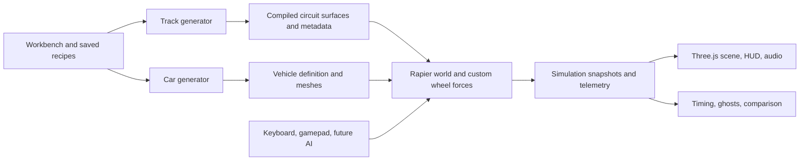

# Procedural Racing — implementation plan

> **Branch policy:** `main` holds the M0–M8 `v0.2.0` baseline. Each future
> milestone uses its own branch from `development`, then is merged and pushed
> to remote `development` on completion for testing. Later releases to `main`
> require an explicit request. See the [release workflow](workflow.md).

> **Validation policy, 26 October 2026:** each development commit uses checks
> targeted to the changed behavior. The full regression suite and production
> build are required before merging into `main`, not for every new feature.
> Documentation-only work uses document/link/diff checks. See
> [validation scope](workflow.md#validation-scope--revised-26-october-2026).

Prepared 25 October 2026; updated 26 October. M0–M8 are implemented, including the
revised M4 v2 generator, [M5 venue construction](m5.md) and
[M6 procedural cars/full workbench](m6.md) and [M7 expanded circuit families](m7.md). See [M4 v2 delivery notes](m4-v2.md) for the non-radial
compiler, section/anchor route design, joint profile fitting and workbench. The
[approved M4/M7 revision](m4-revised-plan.md) and [circuit research](research/circuit-design.md)
supersede conflicting generation details below. V1 and the research lab remain
archived baselines. [M8 solo sessions, ghosts and the circuit library](m8.md) complete the planned solo feature set, released in [v0.2.0](releases/v0.2.0.md); optional M7-D racing bridges remain deferred. Generation qualification uses the
development desktop's Ryzen 5 5600X / 32 GiB; broader hardware testing is still needed.

The current repository baseline is **v0.2.0 (M0–M8)** on `main`; the first
**v0.1.0 (M0–M5)** baseline remains tagged. The complete solo/time-trial feature
set has passed development testing and been approved for this release.
Every future milestone starts from `development` on a separate
`codex/m<number>-<name>` branch and finish by merging and pushing to
`origin/development` for testing; they do not automatically update `main`.

## 1. Agreed product direction

Build a browser racing sandbox around a circuit generator, a procedural car builder, and a modern tuning workbench. The first release is solo driving and time trials. Design the data and control interfaces so AI racing can follow without replacing the vehicle or track systems.

Confirmed requirements:

- Keep the TypeScript, Three.js, Rapier, and Vite foundation used by drift-minigame, subject to an early performance and contact-quality check.
- Target desktop browsers with keyboard and gamepad. Use 1080p/60 fps as the initial benchmark target; select a named reference machine during the first milestone.
- Use one semi-arcade physics model capable of road cars, sedans/touring cars, GT cars, road hypercars, endurance prototypes, open-wheel cars, and oval stock cars. Provide different presets and adjustable assists rather than separate physics implementations.
- Simulate a freely moving chassis supported at four independently evaluated wheel contacts. Pitch, roll, wheel unloading, wheelspin, braking slip, and differences in road surface must have physical consequences.
- Generate closed three-dimensional circuits from curves, with coherent elevation, banking, variable corner radius, and variable width.
- Represent GP-style, touring-car, endurance, street, oval, and road/oval hybrid circuits. Rally stages, hill climbs, cliff roads, and point-to-point routes are out of scope.
- Generate believable kerbs, verges, run-offs, barriers, and basic circuit facilities. No oil-spill hazards.
- Use simple, blocky procedural graphics. Red/white kerbs and appropriate material colours should make the circuit readable. Trees, bushes, stands, and other scenery may use instanced primitives. Cars may use edited, sectioned primitives, with recognizable proportions and silhouettes.
- Make the tuning workbench polished and easy to operate. Keep compact orthographic suspension diagrams visible while driving.

The aim is consistent, understandable vehicle behaviour with forgiving controls. Detailed tire carcass simulation, suspension linkage geometry, CFD, and replication of a particular championship's technical regulations are unnecessary for this scope.

## 2. What to carry forward from drift-minigame

The source was inspected at commit [`641ddddacc167f4d1ff4fbff3df93ca6d40dabb1`](https://github.com/buttery-x3/drift-minigame/tree/641ddddacc167f4d1ff4fbff3df93ca6d40dabb1). At planning time the new repository contained only its README.

| Existing component                                           | Observed behaviour                                                                                                             | Proposed treatment                                                                                                                                                            |
| ------------------------------------------------------------ | ------------------------------------------------------------------------------------------------------------------------------ | ----------------------------------------------------------------------------------------------------------------------------------------------------------------------------- |
| `TrackGeometry.ts`, `TrackGenerator.ts`                      | Seeded exact straights and constant-radius arcs; tangent-continuous biarc closure; overlap rejection; sampled track data       | Reuse the mathematical foundations and test ideas. Extend to designed corner sequences, curvature transitions, independent width/elevation profiles, and stronger validation. |
| `TrackGeneratorPanel.ts` and workshop flow                   | Preview a seed before driving                                                                                                  | Preserve this interaction; expand it into the circuit workbench.                                                                                                              |
| `VehicleController.ts`, `VehiclePhysics.ts`                  | Locks vertical translation and pitch/roll; directly writes linear velocity and yaw rate; samples one surface for the whole car | Replace the driving solver. These assumptions cannot produce the requested suspension/contact behaviour.                                                                      |
| `PhysicsWorld.ts`                                            | Fixed 60 Hz stepping and zero gravity                                                                                          | Retain the accumulator pattern; add gravity, interpolation, and a benchmarked higher-frequency vehicle step.                                                                  |
| `TrackMesh.ts`, `TrackColliders.ts`                          | Flat road visuals and wall colliders; no drivable road collision surface                                                       | Replace with a shared 3D surface compiler for road, kerbs, terrain, and contact metadata.                                                                                     |
| `SurfaceSystem.ts`                                           | Road/grass/oil based on position and distance to centreline                                                                    | Replace with per-contact material queries. Remove oil entirely.                                                                                                               |
| `RaceState.ts`                                               | Proximity checkpoint sequence completes laps                                                                                   | Replace with ordered, directional gate crossings and a real start/finish crossing.                                                                                            |
| Input, camera, seeded randomness, tuning persistence, Vitest | Useful prototype infrastructure                                                                                                | Adapt selectively; introduce analog input, versioned recipes, and modular state.                                                                                              |

Reference files: [vehicle controller](https://github.com/buttery-x3/drift-minigame/blob/641ddddacc167f4d1ff4fbff3df93ca6d40dabb1/src/vehicle/VehicleController.ts), [track generator](https://github.com/buttery-x3/drift-minigame/blob/641ddddacc167f4d1ff4fbff3df93ca6d40dabb1/src/track/TrackGenerator.ts), [physics world](https://github.com/buttery-x3/drift-minigame/blob/641ddddacc167f4d1ff4fbff3df93ca6d40dabb1/src/physics/PhysicsWorld.ts), [race state](https://github.com/buttery-x3/drift-minigame/blob/641ddddacc167f4d1ff4fbff3df93ca6d40dabb1/src/race/RaceState.ts).

Port individual modules into the new architecture rather than copying the old application wholesale. Keep the source commit recorded beside adapted code. Pin compatible package versions and align Three.js with its type definitions during setup; the reference project's dependency versions are a starting point, not a new project's compatibility guarantee.

## 3. Research findings that should influence generation

### Circuit design principles

The FIA's 2026 Appendix O supplies useful reference values for new permanent circuits: 12 m track width, gradual width changes of at most 1 m per 20 m, and a 15 m starting grid extending through the first corner. Grid gradient should stay within 2%. Its ordinary straight drainage crossfall is 1.5–3%; ordinary corner banking guidance is up to 10% gradient, with exceptions. Grade transitions should account for vehicle performance, especially near braking and corners. Run-off placement depends on trajectories and speeds; pit entries/exits should avoid interfering with the racing line. These are reference constraints for the relevant preset, not universal rules for every historical, street, or oval circuit. [FIA Appendix O 2026, Article 7, pp. 18–21](https://api.fia.com/system/files/documents/appendix_o_2026_published_23122025.pdf).

Consequently, distinguish **longitudinal grade**, **drainage crossfall**, and **corner banking**. A straight can have sensible drainage slope. Adverse corner camber should be an intentional exception, disabled in the default generator, rather than an accidental result of terrain noise. Store slopes consistently and label percentages versus degrees explicitly.

Dromo describes circuit design as an iterative relationship between geometry, topography, vehicle trajectories, overtaking, and site constraints. Our interpretation is to generate candidate layouts, evaluate them with representative vehicles, and revise geometry and earthworks together. [Dromo circuit design principles](https://studiodromo.it/insights/circuit-design/).

### Distinct families, shared underlying representation

The ranges below are proposed game-generation presets, not homologation requirements or claims that every real circuit falls inside them. Short layouts can be offered separately without shrinking cars or changing physical units.

| Family           | Starting generation range                             | Layout character to encode                                                                                     | Surface/edge character                                                             | Research anchor                                                                                                                                                                                                                                                 |
| ---------------- | ----------------------------------------------------- | -------------------------------------------------------------------------------------------------------------- | ---------------------------------------------------------------------------------- | --------------------------------------------------------------------------------------------------------------------------------------------------------------------------------------------------------------------------------------------------------------- |
| Modern GP        | 3.5–6.5 km; generally 12–18 m wide                    | Fast, medium, and slow sectors; a strong acceleration/braking opportunity; deliberately widened passing zones  | Designed kerbs, substantial run-off where needed, pit complex                      | [F1 discussion with Apex Circuit Design](https://www.formula1.com/en/latest/article/f1-explains-how-f1-tracks-are-designed-and-the-work-that-goes-into-building.7pdCaqpQJRVdfvxbKd9s4b)                                                                         |
| Touring/club     | 1.5–4.5 km; generally 9–14 m wide                     | Compact rhythm, terrain-following sections, hairpins and flowing corners; fewer enormous paved areas           | Grass verges, gravel where appropriate, smaller facilities                         | [BTCC's Brands Hatch profile](https://btcc.net/circuit/brands-hatch-gp/) documents its hills, dips, and cambers.                                                                                                                                                |
| GT/endurance     | 3–7 km initially; generally 11–18 m wide              | Sustained high-speed sections, mixed corner speeds, room for different class trajectories                      | Broad runoff where required, longer pit facilities, clear merge regions            | [WEC on Bahrain](https://www.fiawec.com/en/news/buemi-eyes-up-fourth-wec-drivers-title-in-bahrain/7800) and [ACO on Mulsanne traffic](https://www.24h-lemans.com/en/news/24-hours-of-le-mans-the-iconic-mulsanne-straight-pushes-drivers-to-their-limit-56359). |
| Street           | 2–5.5 km; generally 9–15 m with deliberate exceptions | Routes constrained by a generated road/block network; straights, junction turns, sweepers, local width changes | Close walls, temporary kerbs, paved escape pockets, urban props                    | [Formula 1 on Marina Bay's converted public roads](https://www.formula1.com/en/latest/article/singapore-grand-prix-helpful-tips-and-information-when-visiting-the-marina.61d1w4TykVZRomD0ox72Vk.61d1w4TykVZRomD0ox72Vk.61d1w4TykVZRomD0ox72Vk).                 |
| Oval             | 0.5–4 km; generally 12–24 m racing width, plus apron  | Short oval, intermediate, D/tri-oval; different turn radii; multiple usable lanes                              | Banking, apron, outer walls/fences, infield and pit road; no obligatory apex kerbs | [NASCAR All American profile](https://www.nascar.com/news-media/2022/04/08/all-american-speedway-track-profile/) shows asymmetric and progressive banking.                                                                                                      |
| Road/oval hybrid | 2–6 km                                                | An infield course joined deliberately to banked oval sections                                                  | Smooth apron/banking transitions, chicanes, protected merges                       | [Charlotte's ROVAL description](https://www.charlottemotorspeedway.com/fans/track-facts/speedway-facts.html).                                                                                                                                                   |

Do not make these mutually exclusive race-series labels. A circuit can support several car classes. Store venue family, layout characteristics, and a separately computed vehicle compatibility report.

Banking needs more than a single universal limit. Zandvoort describes an 18-degree banked corner with progressive cross-track slope and multiple lines; Nashville lists different banking for its corners and straights. The model must therefore support banking that varies both along and across the track. Strong banking will be an explicit authored feature or oval preset. [Circuit Zandvoort](https://www.circuitzandvoort.nl/bochten/), [Nashville track facts](https://www.nashvillesuperspeedway.com/media/track-facts/track-facts.html).

The FIA drawing specification distinguishes apex and exit kerb profiles, and separately identifies gravel and asphalt runoff. Use separate kerb families rather than one raised red/white strip everywhere. [FIA circuit drawing standard, p. 5](https://www.fia.com/sites/default/files/list_of_requirements_for_the_circuit_drawing_2024.pdf).

## 4. Architecture and shared contracts

Keep rendering, simulation, generation, and UI separate. Three.js objects should not be the authoritative vehicle or track data model.



Proposed module boundaries:

```text
src/
  app/                  lifecycle, mode transitions, command handling
  core/                 units, math, seeded random streams, schema versions
  physics/              Rapier adapter, stepping, collision/query groups
  vehicle/              definitions, mass properties, suspension, tires,
                        drivetrain, brakes, aero, assists, telemetry
  generation/terrain/   heightfield, site masks, grading, terrain meshes
  generation/track/     motifs, alignment, profile fitting, surface compiler,
                        driving lines, kerbs, runoff, validation, presets
  generation/car/       archetypes, constrained parameter sampling, body meshes
  rendering/            scene, materials, cameras, LOD, instancing, effects
  workbench/            panels, forms, diagrams, plots, setup comparisons
  input/                keyboard/gamepad mapping, action routing
  race/                 progress, gates, timing, lap validity, ghosts
  storage/              versioned track/car/setup recipes and session records
  diagnostics/          test scenes, batch generation, profiling, replay traces
```

Core contracts:

| Contract            | Contents and purpose                                                                                                                    |
| ------------------- | --------------------------------------------------------------------------------------------------------------------------------------- |
| `TrackRecipe`       | Seed, generator version, family, target length, terrain parameters, motif settings, width/banking policy, surface theme, user overrides |
| `TrackDefinition`   | Analytic alignment/profiles, surface patches, track bounds, kerb/runoff regions, pit paths, gates, reference lines, validation report   |
| `SurfaceHit`        | Point, geometric/contact normal, material ID, collider/triangle or patch ID, local road coordinates, ground velocity, contact validity  |
| `VehicleRecipe`     | Seed, archetype, proportions, component placement, visual options, requested performance envelope                                       |
| `VehicleDefinition` | Validated dimensions, mass/COM/inertia, wheel hardpoints, tires, suspension, drivetrain, brakes, aero and collision shapes              |
| `VehicleSetup`      | User-adjustable values layered over the definition, assist settings, version/hash; preserve original generated vehicle                  |
| `VehicleTelemetry`  | Timestamped chassis state and four wheel states, force/slip/load channels, assist interventions                                         |
| `SessionRecord`     | Track/car/setup/physics hashes, controls, lap validity, timings and ghost samples                                                       |

Use metres, kilograms, seconds, radians, newtons and newton-metres internally. Convert to km/h, degrees, kW/hp, and approachable UI units at presentation boundaries. Use a documented axis convention and one wheel ordering everywhere.

Give terrain, layout, cars, and scenery independent seeded random streams. Adding a tree must not alter a corner or a vehicle's mass. Save recipes plus version identifiers; optionally save the compiled definition for long-lived reproducibility after generator updates.

Use a worker for generation and batch validation. Start simulation on the main thread; move it behind a worker boundary only if measured frame costs justify it. Publish compact typed telemetry snapshots without rebuilding the UI on every physics tick.

## 5. Semi-arcade vehicle physics

### Chassis and four contacts

Use one Rapier dynamic chassis with all six rigid-body degrees of freedom and gravity. Each wheel has a suspension attachment, travel direction, travel limits, radius, steering angle, angular speed, and independent surface contact.

The first implementation uses effective spring/damper suspension and virtual rotating wheels. It does not require four additional rigid wheel bodies or full suspension linkages. This is the intended fidelity boundary: real chassis motion and per-wheel forces, with simplified unsprung dynamics.

Prototype one ray per wheel on smooth roads, then evaluate a small footprint or shape sweep for kerbs and surface edges. All samples for a wheel resolve to one contact patch/load; do not multiply tire force by the number of probes. Filter out the chassis, scenery-only geometry, unsuitable steep faces, and unrelated colliders. Treat walls through chassis collision, not as road supporting the suspension.

Rapier provides ray/shape scene queries and a built-in raycast vehicle controller. Use the built-in controller as a benchmark/reference rig. Prefer our own wheel-force layer for controlled tire curves, wheel rotation, differential behaviour, assists, and explainable telemetry; do not run both driving solvers on the same chassis. [Rapier scene queries](https://www.rapier.rs/docs/user_guides/javascript/scene_queries/), [vehicle-controller API](https://rapier.rs/javascript3d/classes/DynamicRayCastVehicleController.html).

### Suspension and body motion

- Compute compression from contact distance and wheel radius. Use relative attachment/contact velocity for damping, with bounded filtering to avoid noisy force spikes.
- Calculate spring, compression/rebound damping, and progressive bump-stop forces. Unloaded wheels cannot pull the road toward the car; droop limits and contact loss are explicit states.
- Apply support and tire forces at physically consistent locations on the chassis. Lever arms relative to the centre of mass (COM) create pitch, roll and yaw.
- Add front/rear anti-roll coupling. It must respect available contact force and allow a wheel to unload; it must not glue both wheels to the road.
- Derive baseline spring rates from effective corner mass and a target ride frequency: `k = (2*pi*f)^2 * m_corner`. Derive damping from a damping ratio, then expose understandable front/rear settings.
- Calculate static corner weights, ride height, travel headroom and inertia from the actual generated definition. Visual wheel movement follows suspension state.
- Do not add a separate canned load-transfer force on top of load transfer already produced by the rigid body and suspension. Validate dynamic loads against expected trends.
- Preserve chassis underside collision for bottoming and rollover. Keep visual body lean faithful to simulation; optional diagram amplification is labelled and affects diagrams only.

### Tires and wheel rotation

For every grounded wheel, build a forward/lateral basis in its contact plane. Compute point velocity from chassis translation and angular motion, subtract ground velocity, and resolve it into that basis.

Maintain wheel angular speed explicitly. Longitudinal slip comes from the difference between tire circumferential speed and road speed; slip angle comes from lateral versus forward travel. Use a smooth, regularized low-speed treatment that also works in reverse.

Use tunable tire curves with:

- A near-linear response around small slip, a controllable peak, and a broad, gradual sliding region.
- Combined longitudinal/lateral grip limiting: braking or wheelspin consumes some of the same capacity needed for cornering.
- Load sensitivity so twice the vertical load does not automatically produce twice the useful grip at the same coefficient.
- Tire and surface parameters kept separate. Gravel or grass under one wheel changes that wheel's forces.
- Modest transient relaxation to avoid instantaneous tire-force changes; keep it stable across low speed and contact changes.
- A low-speed static-hold/contact treatment for parking and gentle launch. Merely dividing by an epsilon is insufficient to prevent rest jitter or slope creep.

Integrate wheel rotation from drive torque, brake torque, tire reaction torque and rotational inertia. Brake torque opposes rotation without numerically overshooting through zero every step. A wheel with no contact has no tire traction, but can still spin under drive torque.

No tire temperature, wear, pressure thermodynamics, detailed carcass deformation, or aquaplaning is required for the initial release. Avoid presenting unsupported sliders as meaningful physics.

### Drivetrain and brakes

Represent engine placement separately from driven wheels. `FR`, `MR`, `FF`, `RR`, and `AWD` are useful derived labels, not the entire schema. An AWD car can have a front or mid engine.

- Engine torque curve, idle/redline, throttle response, engine braking, gear ratios, final drive and shift timing.
- Automatic gearbox by default; optional manual shifts and automatic clutch assistance.
- Per-axle drive allocation; AWD front/rear split and a centre-coupling model.
- Open, limited-slip and locked differential presets. Open differentials distribute equal axle torque subject to their model; limited-slip permits bounded bias. Do not silently give all torque to whichever wheel is grounded.
- Per-wheel braking with front/rear bias, optional ABS and traction control. A handbrake can operate a configured axle.
- Steering geometry based on wheelbase and track width, with an adjustable Ackermann approximation and speed-sensitive input limits.

Power, gearing, aerodynamic drag and tire traction determine performance. Avoid using a hard `maxSpeed` clamp as the primary powertrain model.

### Aero and forgiving control

Add aerodynamic drag and front/rear downforce proportional to airspeed squared, applied at explicit centres of pressure. Aero must load the chassis and suspension; do not also add the same downforce directly to wheel loads. This supports the major distinction between a soft road car and an aero-dependent prototype or open-wheel car without a separate simulation.

Keep assists explicit, bounded and visible: steering smoothing, countersteer assistance, yaw stabilization, ABS and traction control. Make them presets with independent controls. Apply corrections through steering/brakes or a documented small corrective torque, not by replacing the body's orientation or velocity every frame. Reduce ground-dependent assists when airborne.

Provide at least `Accessible`, `Balanced`, `Direct`, and `Drift` baseline setups. These are tuning bundles, not separate physics modes. The workbench must explain when an assist is causing an apparent handling change.

### Integration and numerical stability

Start with a 120 Hz fixed simulation step and interpolated rendering, then benchmark. Use bounded substeps when needed for difficult tire/suspension states. Apply forces once per physics step in a documented order: controls, contacts, suspension, drivetrain/tires, aero/assists, rigid-body integration, telemetry.

Reset transient forces correctly. Handle tab suspension and long frames without unbounded catch-up. Pause time trials on focus loss or mark the run appropriately. Use CCD for fast chassis impacts and test wheel contact continuity separately; chassis CCD does not automatically fix missed kerbs between wheel queries.

## 6. Procedural car construction

Generate a coherent vehicle specification first, then create its physics and visual meshes from that same specification.

Generation order:

1. Pick an archetype and performance band.
2. Choose wheelbase, front/rear track, overhangs, body width/height, wheel radius/width and ground clearance within correlated ranges.
3. Place engine, occupants, drivetrain and other major mass components.
4. Compute mass, COM and inertia, including component offsets. Ensure collider mass and explicit mass properties are not counted twice.
5. Select tires, suspension, brakes, powertrain and aero appropriate to the resulting load and performance.
6. Build collision shapes and visible geometry from the same dimensions and axle coordinates.
7. Run packaging, equilibrium and basic driving checks. Repair within the archetype's constraints or reject the candidate.

| Archetype                   | Recognizable construction                                                    | Main handling differences to expose                              |
| --------------------------- | ---------------------------------------------------------------------------- | ---------------------------------------------------------------- |
| FF hatch/touring car        | Short bonnet, tall cabin, two-box outline, front powertrain                  | Front weight/drive demand, power understeer, rear unloading      |
| FR coupe/sedan              | Longer bonnet, cabin behind engine, distinct rear deck                       | Rear traction under acceleration, controllable power oversteer   |
| MR sports car/road hypercar | Low nose, forward cabin, rear engine volume, wide rear body                  | Centralized mass, rear traction, quick yaw response              |
| RR coupe                    | Rear mass volume and compact front                                           | Rear weight bias and different transient balance                 |
| AWD car                     | Body type independent of drivetrain label                                    | Torque split, coupled axle behaviour, traction on mixed surfaces |
| GT/endurance prototype      | Low wide body, wings, pronounced wheel volumes; cockpit according to subtype | Higher tire/aero capacity, low ride height, firm suspension      |
| Open-wheel                  | Narrow central body, visible wheels, nose and wing elements                  | Low mass, substantial aero, clearance and kerb sensitivity       |
| Stock car                   | Broad sedan silhouette, long body and wheelbase                              | Greater mass/inertia, oval-oriented setup options                |

Use longitudinal cross-sections with editable widths/heights, connected into low-poly body panels. Add primitive cabin, bonnet, boot, bumpers, fenders, lights, wheels and optional wings. Place windows/lights as simple contrasting panels. Keep wheel arches compatible with steering and suspension travel. Avoid random disconnected boxes that obscure the archetype.

Expose separate randomization locks for mechanics, proportions, and appearance. Changing paint must preserve handling. Allow parameter overrides with immediate validity feedback. Front/rear setup controls suffice initially, with per-corner override support for asymmetric oval setups.

The first release should include validated example vehicles for every row above; shared components can cover multiple archetypes. Procedural output is constrained variation around credible families, not uniformly random values for every field.

## 7. Track representation and generation

**Revision:** implement the staged site/sequence hybrid and non-radial compiler in
[M4 revised](m4-revised-plan.md). The original intent below was not fully realized
by v1. Keep its useful continuity/physics constraints, but do not treat v1's radial
proposal/meshing architecture as the foundation for extended circuit families.

### A road surface, not just a centreline

Represent the circuit using:

- Horizontal curve alignment with exact straights/arcs and smooth transition segments.
- Elevation as an independent profile along horizontal station `u`.
- Independent left/right widths `wL(u)` and `wR(u)`.
- A cross-section function supporting crown, crossfall, uniform banking and progressive banking.
- Semantic regions for corners, entries, apexes, exits, braking zones, kerbs, verges, runoff, barriers and pits.
- A mapping from horizontal station to true 3D lap distance `s`; use the latter for timing/progress and distance displays.

Build a stable local tangent/lateral/up frame with parallel transport and explicit closed-loop seam correction. Do not rely on an unconstrained Frenet frame that can flip at straights or inflections. Derive road normals from the actual surface derivatives/triangles.

A cross-section can be expressed conceptually as `R(u,v) = C(u) + v*B(u) + h(u,v)*N(u)`. Here `v` is lateral position, `B/N` form the unbanked transverse frame, and `h` defines crown/bank shape. Uniform banking and progressive banking are different functions; rotating a single flat strip cannot reproduce both.

Preserve the curve-based generation approach. Add variable curvature through transition curves or constrained spline segments, with curvature continuity at joins. A decreasing-radius corner and a narrowing road are separate controls. Validate offset edges as well as the centreline, especially at tight radii and width changes.

Recommended first implementation: retain analytic straights/arcs, add numerically integrated segments with a smooth curvature profile, and solve a bounded set of segment lengths/curvatures for closure. Use a periodic smooth elevation profile and smooth width/bank profiles over that alignment. This keeps geometric intent inspectable; arbitrary freeform spline editing can follow later.

Use adaptive longitudinal and cross-track sampling based on curvature, elevation and cross-section error. Straight, flat areas need few triangles; kerbs and banking transitions need more. Render meshes, collision surfaces and surface classifications must derive from the same compiled definition. Small texture detail should not silently become collision detail.

### Generation pipeline

1. **Choose a design brief.** Family, length, terrain character, speed envelope, representative vehicle classes, corner mix, runoff theme, and difficulty.
2. **Create a site.** Seeded low-frequency Perlin/simplex/fBm terrain with bounded slopes. Add higher-frequency scenery detail only outside the driving/graded corridor. Urban and oval sites generally use flatter source terrain.
3. **Reserve facilities.** Place a plausible start/finish and pit/paddock zone on suitable land, plus room for access and run-offs, before packing the rest of the circuit around it.
4. **Create a semantic layout.** Compose straights, sweepers, hairpins, esses, chicanes, and compound corners. Allocate meaningful fast/slow rhythm and passing opportunities. Street and oval families use their own composition rules.
5. **Fit candidates to the site.** Vary heading, placement, lengths and radii against slope, earthwork and clearance costs. Use terrain as an influence, not an instruction to copy every contour.
6. **Solve closure.** Distribute correction across several adjustable sections. Enforce position, tangent and curvature continuity; avoid an arbitrary last corner absorbing the entire error.
7. **Fit elevation.** Smooth the terrain samples into a vertical profile with bounded grade and vertical curvature, periodic height/grade at the seam, and a calm grid region. Revisit the horizontal route if earthworks are excessive.
8. **Fit widths and crossfall.** Broaden selected entries/exits/passing areas; narrow gradually where intentional. Smooth banking transitions and validate their interaction with elevation and vehicle travel.
9. **Estimate driving lines and speeds.** Produce class-specific candidate lines and forward acceleration/backward braking passes. Include grade, banking, tire capacity and aero, then use simulated driving to check the approximation.
10. **Place kerbs and escape areas.** Use the expected trajectories and corner semantics; reserve/grade their land and locate barriers outside the planned envelopes.
11. **Grade the site.** Cut/fill beneath the road, verges and runoff. Blend back to untouched terrain over a controlled distance. Add embankments/retaining structures only where they do not create the excluded cliff-road character.
12. **Compile and validate.** Build meshes, colliders, materials, checkpoints, pit paths and metadata. Reject invalid designs, retain explicit reasons, and retry within a bounded budget.
13. **Dress the venue.** Place buildings, stands, trees and other props only after the driving and clearance regions are fixed.

Use hard validity constraints plus a scored quality objective: layout variety, usable braking/passing zones, terrain integration, earthwork cost, readability, and adherence to the chosen family. No single score such as corner-count or hairpin-count defines a good circuit.

Generation must have progress, cancellation, bounded retries, and a known-valid fallback per family. Report when a fallback was used and preserve the original recipe and reason. Do not silently claim a failed seed produced its requested circuit.

### Elevation and camber policy

- Default road-course grade target: roughly within ±6%, with an optional deliberate hill profile up to about ±10%. These are initial game constraints to tune, not FIA limits.
- Default ordinary corner banking: modest positive banking or near-level crossfall. Adverse camber defaults to zero frequency; an advanced option may introduce a small number of intentional sections.
- Use a speed-dependent crest/compression check. A small slope can still contain a sharp, destabilizing vertical bend. Reject unintended launch crests and severe bottoming for the intended vehicle envelope.
- Keep high-speed braking zones especially smooth. Signature crests require a controlled approach and clear preview, and should not appear as incidental noise.
- Oval banking may start in a broad 0–30 degree design range with dedicated validation, while progressive profiles can increase slope across lanes. Strongly banked road corners are explicit exceptions.
- Blend bank transitions across enough distance to control chassis roll rate and suspension load; constrain the resulting surface, not merely the numeric bank slider.
- No racing-route bridges/overpasses in the initial release. Reserve IDs and 3D query support for later layered geometry. Decorative access bridges may be added with clearance validation.

### Driving lines and compatibility

A minimum-curvature or minimum-time approximation should operate within legal track bounds, with a car-width margin. Produce multiple plausible paths where a track is intended for passing; do not mistake the centreline for the racing line.

Re-evaluate exit priorities for linked corners. One isolated geometric apex is not always the useful apex of a compound sequence. Oval lanes need distinct path lengths and grip/banking conditions.

Use representative slow, medium, and fast vehicles to validate the family. Save speed, braking, sight-distance and clearance summaries as diagnostics. A player's extreme tune can receive a compatibility warning without regenerating the circuit or making the entire seed invalid.

Future AI can consume the same paths and control interface, but a generator test driver is not yet racing AI: overtaking decisions, traffic avoidance, starts and racecraft remain later work.

## 8. Kerbs, runoff and circuit identity

### Kerbs

Place kerbs in contiguous, tapered regions:

- Inside the useful apex region where cutting is plausible.
- On the outside of selected corner entries where the setup line uses the edge.
- On the outside of exits where the trajectory opens out.
- Around chicane changes of direction where the semantic layout justifies them.

Do not stripe the entire circuit boundary. Consider compound corners, pit openings, wall clearance and expected wheel paths. Give kerbs low entry/exit transitions, credible width and a selectable low/raised profile. Start with forgiving profiles, then expose rougher profiles as track options.

Red/white striping follows world distance along the kerb, so stripe sizes remain consistent across mesh segments. Use a small set of surface colours and simple geometry for readability. Provide different tire response/audio for kerbs.

Represent broad kerb shape physically; keep fine ribs chiefly visual/audio or analytically filtered. Tiny individual teeth can alias badly at racing speed. Add more physical detail only after high-speed contact tests justify it.

### Runoff and barriers

Design runoff by corner and likely departure direction, not as a fixed-width ring around the circuit. Approximate a fan of missed-braking and understeer trajectories from several points along the expected racing lines. Include approach speed, grade, assumed deceleration, and remaining speed at the barrier. This is a game-design plausibility check, not a real-world safety certification.

If space is inadequate, change the corner, reduce the intended approach speed, move nearby sections, or select a different site. Street profiles may use planned paved escape routes and impact barriers; the solution is not simply to put a wall across every straight-ahead departure path.

| Material       | Visual treatment                                      | Proposed physical distinction                                                              |
| -------------- | ----------------------------------------------------- | ------------------------------------------------------------------------------------------ |
| Racing asphalt | Medium/dark grey, restrained markings and racing line | Primary tire-grip surface, low rolling resistance                                          |
| Tarmac runoff  | Grey with contrasting boundary/paint treatment        | Drivable grip; illegal for gaining lap time even when physically similar to the road       |
| Grass          | Green variation and simple edge patches               | Less predictable grip, increased resistance; not treated as a powerful stopping surface    |
| Gravel         | Grey/tan aggregate appearance                         | Greater rolling/ploughing resistance, reduced steering authority, possible gradual bogging |
| Sand           | Pale ochre/beige                                      | Separate loose-surface response, more drag/bogging where deep; no instant arbitrary stop   |
| Kerb/paint     | Red/white and boundary colours                        | Profile, grip and vibration distinct from road; material parameters remain tunable         |

Keep grip, rolling resistance, ploughing resistance, roughness and visual colour separate. Sand surrounding a desert circuit does not mean every engineered runoff is sand. Track themes should choose a sensible mixture of materials.

Sample each wheel's actual footprint/material, with bounded mixing at material boundaries. Do not switch the whole car to grass because its centre crossed an edge. Make gravel/sand resistance bounded so entering the material cannot create a numerical impulse or reverse motion in one step. Allow recovery/reset if bogged.

Use continuous collision geometry for barriers, avoiding exposed segment ends that snag cars. Add plain wall, tire-stack and modular impact-barrier appearances as simple primitives. Use low-bounce collision tuning; detailed barrier deformation is unnecessary initially.

### Facilities and primitive scenery

Generate start/finish paint, grid boxes, pit lane and wall, garage blocks, braking boards, distance/corner markers, marshal posts, fences and modest grandstands. Facilities should respond to venue scale: a club circuit should not automatically get an enormous GP complex.

Use cones/cylinders and clustered low-poly canopies for trees; small grouped primitives for bushes; stepped boxes and a roof for stands. Add urban building blocks for streets. Place vegetation in terrain-compatible clusters, outside runoff, clear sight corridors, access routes and barrier footprints.

Use instancing, distance culling and simple LODs. Decorative vegetation normally needs no collider; keep gameplay colliders limited to objects the car can meaningfully reach. Scenery generation uses its own seed and density control.

## 9. Modern workbench and on-track diagrams

### Workbench layout

Use a full-window workspace with a large central 3D viewport, a compact top session bar, a left navigation rail, a right inspector, and an optional bottom telemetry strip. Major views: **Drive**, **Car**, **Setup**, **Track**, and **Compare**. Panels should have clear hierarchy, readable typography, consistent spacing, and restrained colour accents.

The art can stay blocky while the interface is contemporary. A raw `lil-gui` panel is useful for internal debugging but is not the final tuning interface. Implement reusable typed UI controls and stable panels; keep Three.js's render loop independent of form updates.

Controls:

- Slider plus numeric input, visible units, sensible range, reset-to-preset, and short explanations.
- Paired front/rear controls, link/unlink where useful, and an advanced per-wheel mode.
- Basic/advanced disclosure so users can first adjust balance, stiffness and assist level, then inspect the underlying values.
- Save, duplicate, rename, undo/redo, compare A/B, and export/import recipes.
- Highlight changes from a saved setup; display derived outputs such as weight distribution, static ride height, spring frequency, power-to-weight and gearing.
- A car preview that updates geometry and shows engine location, driven axles, COM and wheelbase/track dimensions when selected.
- Track views for overhead layout, orbiting 3D, elevation profile, width, banking, estimated speed and runoff placement. Highlight failed constraints on the corresponding section.

Apply runtime tuning atomically at simulation-step boundaries. Structural changes such as wheelbase, mass distribution or chassis geometry require a paused rebuild/reset with a clear Apply action. Power/suspension/tire changes can be previewed live where stable, but invalidate the current timed lap. A/B tests use the same spawn, inputs and conditions.

Gamepad navigation should reach common actions. UI focus must prevent typing in a number field from driving the car. Provide remappable inputs, dead zones, response curves and a live input meter.

### Bottom-corner orthographic instrument

Use a compact three-panel instrument:

1. **Front view:** actual chassis roll, wheel positions, left/right suspension compression, road cross-slope and load bars.
2. **Side view:** pitch, front/rear suspension travel, road grade and bottoming/droop indicators. Show the selected side or a clearly labelled axle average.
3. **Top view:** steering angles, driven-wheel indicators, slip/traction state per wheel and COM marker.

Display body attitude relative to the local road as the main handling signal, with a separate gravity/world reference. Otherwise a car simply sitting on a banked corner would misleadingly appear to have excessive suspension roll.

Estimate the local road reference from the valid wheel contacts and nearby road frame. When contacts are insufficient, use the last stable reference briefly and mark it unavailable/airborne rather than displaying a fabricated road attitude.

Show contact loss distinctly; do not draw a normal load bar for an airborne wheel. Use labels and shapes as well as colours. Numeric roll/pitch and load values remain accurate if optional diagram motion amplification is enabled. Draw these views from telemetry using SVG/Canvas, not extra 3D scene renders.

The expanded workbench adds short history plots for speed, throttle/brake, yaw rate, roll/pitch, wheel loads, travel and slip. Capture a ring buffer, freeze a moment, scrub the trace, and compare saved runs. UI refresh can be lower than physics frequency while retaining full-resolution recorded samples for diagnostics.

## 10. Driving, time trials, presentation and persistence

- Keep chase, bonnet and overhead cameras. Filter camera roll independently from body roll for comfort; provide collision avoidance, terrain clearance and adjustable look-ahead.
- Animate suspension, wheel rotation and steering from the simulation. Emit skid marks and smoke at contacting wheels based on slip and dissipated energy, not a global drift-angle threshold.
- Use simple engine/load audio, tire scrub/squeal, kerb rumble, gravel/sand sounds and impacts. Prioritize feedback over expensive visual effects.
- Provide daylight lighting, coherent shadows, restrained fog and surface colour variation. No photorealistic asset pipeline is required.
- Time laps on simulation time using ordered directional gates and interpolated crossing times. Require a valid start/finish crossing after all sectors, with 3D gate bounds to avoid credit from nearby track sections.
- Define track limits explicitly; leaving the allowed racing region or using runoff to cut a corner invalidates the lap. Reset, structural changes and setup edits also invalidate it.
- Offer practice, timed laps, sector deltas, personal best and a non-colliding ghost. Store ghost poses as well as inputs; do not promise bit-identical physics replay across browsers or future engine versions.
- Key results by track, car, setup, assist and physics versions. A changed car or physics build must not silently inherit a comparable leaderboard record.
- Save locally with versioned schemas, import/export JSON and a small library of favourite seeds. Use IndexedDB for larger traces/ghosts. No account/backend is necessary for the first release.

Future AI should consume `VehicleControls` just like the player. Keep race-session state separate from vehicle ownership. Online multiplayer, traffic racecraft, damage, weather, tire wear, fuel strategy and career progression are later projects, not dependencies of this release.

## 11. Validation and performance gates

Tests should catch physical or geometric failures, not simply repeat formulas from the implementation. Keep a small library of authored diagnostic tracks independent of procedural generation.

| Area            | Required checks                                                                                                                                                                                          |
| --------------- | -------------------------------------------------------------------------------------------------------------------------------------------------------------------------------------------------------- |
| Suspension      | Static equilibrium matches total weight and expected axle split; drop settles without persistent oscillation; one-wheel bump produces the correct roll/travel response; droop and bump stops are stable  |
| Tires           | Gentle start/stop and reverse work; parked car is stable; brake/drive force competes with lateral grip; split-grip braking affects yaw; airborne wheels generate no traction                             |
| Drivetrain      | FF/FR/MR/RR/AWD example cars differ for the intended reasons; differentials respond sensibly to one unloaded wheel; torque and brake accounting has consistent units                                     |
| Body/aero       | Acceleration squat, braking dive and cornering roll are visible and consistent with COM; downforce increases with speed; aero is not counted twice                                                       |
| Contacts        | Kerb traversal at low/high speeds and oblique angles; road seams; banked surfaces; grass/gravel borders; underside collision; rollover/reset                                                             |
| Geometry        | Closed position/tangent/curvature/elevation/width/crossfall seams; no folded triangles; no offset-edge self-intersection; no overlapping road/runoff/barrier regions; collision and render heights agree |
| Circuit quality | Intended family recognizable; representative vehicles complete laps; sufficient braking distance; no incidental launch crests; plausible runoff and pit merges; appropriate use of kerbs                 |
| Timing          | Reverse crossings, skipped gates, corner cuts, resets, pauses and setup changes cannot create valid false laps                                                                                           |
| Reproducibility | Same seed/version/settings produces the same generated definition; changing scenery does not change geometry or car mechanics                                                                            |
| UI              | Keyboard/gamepad operation, focus routing, value validation, undo, preset round-trip, correct telemetry labels and road-relative attitude                                                                |

Initial proposed tolerances to tune during the rig milestone: settled total wheel load within about 2% of weight on a level test pad; static axle distribution within a few percentage points of the analytical target; smooth-road visual/contact height discrepancy under roughly 1 cm near the car; no unexplained energy growth in coast/drop tests. Document justified exceptions instead of loosening checks globally.

Run a deterministic smoke set on every change to generation. For milestone acceptance, attempt at least 1,000 seeds per family, recording success rate, rejection reasons and worst cases. Target at least 99% successful generation for supported default recipes within the attempt budget; never return invalid geometry merely to satisfy the success metric. Fully simulated lap checks can use a smaller stratified set of seeds, with all failures retained as fixtures.

Measure native generation success separately from fallback delivery. A fallback must not inflate the generator's success rate. Keep a diversity report alongside validity results so repeatedly producing similar layouts does not count as satisfactory procedural variety.

Performance targets on the selected reference desktop:

- 60 fps at 1080p for one car and a complete venue, with measured CPU/GPU frame times and a quality fallback.
- 120 Hz physics while keeping simulation plus telemetry comfortably inside the frame budget; an initial main-thread allocation around 4 ms per rendered frame is a target to measure.
- Typical track generation in a few seconds in a worker; progress and cancellation for expensive recipes.
- No unbounded memory growth across repeated car/track regeneration; dispose meshes, colliders and event listeners.
- No per-frame allocation proportional to the full circuit or telemetry history. Use chunked surfaces, spatial queries, instancing, pooling and typed buffers where profiling shows benefit.

Profile several vehicle instances as a future-AI stress case, but do not delay the solo release to promise a specific AI grid size. Keep collision fidelity near drivable areas while lowering scenery detail first when performance is constrained.

## 12. Delivery sequence

Each milestone ends with something inspectable or driveable. The first tiny playable slice arrives before broad procedural content; the full requested release requires the later family and workbench milestones too.

| Milestone                              | Main work                                                                                                                                   | Completion gate / review artifact                                                                             | Depends on |
| -------------------------------------- | ------------------------------------------------------------------------------------------------------------------------------------------- | ------------------------------------------------------------------------------------------------------------- | ---------- |
| M0 — Foundation                        | Scaffold browser app; define units/schemas/seeds; pin dependencies; adapt input/camera; select benchmark machine                            | Empty test venue, typed build/tests, recorded frame baseline, architecture decision notes                     | None       |
| M1 — Suspension rig                    | Free chassis, four contacts, springs/dampers, bump/droop limits, mass properties; modern workbench shell and front/side diagrams            | Drop test, slope test and one-wheel bump; live roll/pitch and loads agree with the scene                      | M0         |
| M2 — Driveable model                   | Tire curves, wheel rotation, steering, brakes, gearing, differential types, assists, simple aero; handcrafted reference cars                | FF/FR/MR/AWD driving comparison on a flat diagnostic circuit; stable stopping/reversing and controlled slides | M1         |
| M3 — 3D surface compiler               | Alignment/profiles, variable width, road normals, contact metadata, terrain/kerb colliders; authored hills and banked test tracks           | One car drives a hill, compound corner, bank transition and mixed surfaces without seam/contact faults        | M2         |
| M4 — Circuit design v2                 | R0 proposal study; R1 non-radial compiler; R2 strategic routes and smooth motifs; R3 joint road/terrain fitting; R4 production workbench    | Driveable v2, diversity portfolio, vehicle laps and 1,000-seed qualification per preset; see delivery notes   | M3         |
| M5 — Circuit dressing                  | Reference lines/speeds, semantic kerbs, runoff envelopes, material physics, barriers, pits, primitive scenery                               | Recognizable racetrack with useful entry/apex/exit kerbs, distinct off-track surfaces and valid escapes       | M4         |
| M6 — Car generation and full workbench | Constrained archetypes, sectioned-primitive bodies, COM/inertia derivation, full setup UI, saved A/B comparisons                            | Validated examples spanning all car families and layouts; geometry and physics stay in agreement              | M2, M5     |
| M7 — Family completion                 | Inherited rural/urban/airfield networks; oval/progressive banking and hybrids; extended endurance scale; separately optional layered routes | Distinct site-driven families, multi-lane/escape/transition tests, long-venue performance; see revised M7-A–D | M5, M6     |
| M8 — Solo release                      | Proper laps/sectors, limits, ghosts, saved library, audio/effects, camera/UI polish, performance pass                                       | All requested families and archetypes usable in solo practice/time trials with the workbench and diagnostics  | M6, M7     |

Critical path: suspension/contact stability → tire/drivetrain behaviour → 3D road/contact agreement → terrain fitting → kerbs/runoff → complete car/track families → release validation.

**M6 delivered:** 11 constrained car families with FF/FR/MR/RR/AWD options,
component COM/full-tensor inertia, dimension-aware wheels/collision and sectioned
body meshes; seeded preview with physical acceptance checks; the full tuning,
garage/A/B comparison, recorder and input workbench. Qualification passed 11,000
car seeds, 33 physical acceptance cases and 22 dressed circuit laps; the complete
suite passes 188 tests. See [delivery details and limits](m6.md) and the
[source-hashed report](research/m6-qualification.json). It was integrated into
`development` for testing and is included in the released v0.2.0 baseline.

**M7 delivered:** inherited urban/rural/mountain/airfield road networks, dedicated
oval/tri-oval/asymmetric speedways, progressive lane/apron banking, road/oval
hybrids and 8–24 km endurance venues. The workshop adds provenance, variants,
cross-sections, class/lane estimates and accepted-definition import/restore.
Collision, surface GPU buffers and scenery use local residency; long-lap,
multi-lane and named-desktop measurements are recorded separately. See
[delivery details and limits](m7.md). Optional M7-D racing bridges remain future work.

**M8 delivered:** simulation-time laps and three sectors through ordered directional
3D gates; tyre-centre limits, pit/wrong-way warnings and interruption validity;
car/setup/assist/physics-keyed personal bests and non-colliding 20 Hz pose ghosts;
versioned session import/export and a named/favourite accepted-definition circuit
library. Bounded skid/dust/smoke effects, synthesized engine/tyre/impact audio,
bonnet/chase camera controls and quality fallback complete the solo presentation.
The physical campaign qualifies 25 timed laps and ghost round trips across all
seven expanded track families and eleven procedural archetypes. Browser and
performance evidence have separate scopes. See [M8 delivery notes](m8.md).
The milestone and tyre-feedback follow-up were tested on `development`, then
approved for promotion to `main` as v0.2.0. The release retains the existing
branch/testing policy for future work.

Start UI work in M1 and develop it alongside physics; do not leave the workbench as a final skin over debug controls. M2 is the first handling-review build. M5 is the first convincing procedural circuit build. M8 is the complete first-release scope.

Avoid calendar estimates until M1–M3 establish contact quality and generation cost. The largest uncertainties are tire/kerb behaviour, robust closed-surface generation, and tuning the full vehicle range; settle those before investing heavily in decorative content.

## 13. Main risks and planned responses

| Risk                                         | Planned response                                                                                                                                                 |
| -------------------------------------------- | ---------------------------------------------------------------------------------------------------------------------------------------------------------------- |
| Ray contacts miss or snag kerbs              | Compare rays, footprint probes and shape sweeps in the diagnostic rig; use low kerb profiles and temporal continuity checks; separate visual ribs from collision |
| Suspension or tires become unstable          | Fixed steps, appropriate damping, low-speed treatment, force/torque budgets, drop/coast tests, bounded setup ranges                                              |
| Every generated car feels alike              | Derive COM/inertia from packaging; preserve tire/load/drivetrain/aero differences; compare repeatable maneuvers and telemetry                                    |
| Accessible assists erase layout differences  | Expose intervention traces and limits; compare assist-on/off; never use unconditional yaw/velocity replacement                                                   |
| Terrain produces implausible roads           | Optimize route and grade together; reserve facilities/runoff; bound earthworks and reject unsuitable candidates                                                  |
| Track closure produces an ugly final section | Spread correction across several segments, enforce seam derivatives, score the closure region and use known-valid fallbacks                                      |
| Too many valid but dull tracks               | Motif grammar, family-specific quality targets, class-specific lines/speeds and human driving reviews                                                            |
| Workbench overwhelms the user                | Basic/advanced controls, diagrams beside settings, derived values, curated presets and A/B comparison                                                            |
| Large venues are expensive                   | Chunk meshes/colliders, instance scenery, worker generation, spatial queries, adaptive road sampling and independent scenery quality                             |
| Saved tracks/replays change after updates    | Version and hash all recipes/physics; retain baked definitions/ghost poses when reproducibility matters                                                          |

## 14. Clarifications and defaults

The architecture-level questions are resolved: browser stack, solo/time trials first, broad vehicle support through tuning, desktop keyboard/gamepad, and simple blocky procedural visuals with a modern UI.

Working defaults that can be changed during implementation without reopening the architecture:

- “Hypercar” includes both road hypercars and an endurance-prototype archetype; keep them separate presets.
- Prototype with a balanced handling preset and expose forgiving/direct/drift alternatives immediately.
- Start with daylight, dry conditions and persistent collision geometry; add cosmetic effects incrementally.
- Use left/right or front/rear property controls where understandable, with advanced per-corner settings for oval setups.
- Keep rally, hill-climb and cliff-road content excluded even when terrain is hilly.
- Include pit geometry and recognizable facilities in the first release; pit-stop strategy and race operations belong to later AI/race work.
- Select a specific reference desktop/GPU in M0. Until then 1080p/60 fps is a design target, not a measured claim.

No further user decision is required to begin M0–M1. Handling feel should be reviewed on the M2 driving build, where the alternatives can be compared rather than settled only in prose.

## 15. Separate synthesized driving audio — 26 October 2026

The user approved the [audio plan](research/audio-system.md) as separate work
after completed M8, with sound enabled by default. The feature uses
`codex/synthesized-driving-audio` and integrates into development for testing.
See [implementation and qualification](audio.md).

The native graph implements RPM/load/shift engine layers, four per-wheel
near-limit and slip voices, headphone HRTF positioning reinforced by axle timbres,
stereo/mono fallback, an independent mixer and persistent mute. Physics-step
capture, gesture activation and bounded pause/reset/disposal are integrated into
the app. The standalone Audio lab provides actual renders, lifecycle checks
and a human identification test; the driving diagnostic exercises the actual app
through launch, shift, stopping and relaunch. The user removed the 20-minute
endurance run from required checks.

Human recognition and acoustic end-to-end latency remain unmeasured; automated
spectral/channel checks do not substitute for listening. This work leaves M8
completed and preserves its release and qualification records.

The user's subsequent sound-quality review rejected the original engine's buzzy
timbre and the tyres' whistle-like tone. Preserve this implementation as the audio
infrastructure baseline. The [sound playground research](research/audio-timbre.md)
led to an accepted pulse/exhaust engine direction, a rejected rain-like tyre
source, then a rejected tonal tyre source. The [supplied-WAV comparison](research/tyre-recording-comparison.md)
now measures moving spectral bands and changing early/middle/late character
missing from the tuned synthetic recording. The user accepted the resulting
[reconstruction comparison](research/tyre-reference-audition.md), and the approved
[live-control screech](research/controlled-tyre-screech.md) was subsequently accepted.
The authorized [driving integration](research/reference-audio-integration.md) now
uses those engine/tyre defaults with real per-wheel controls and the established
surface/spatial/mixer foundation. The next step is owner listening in the
simulation, with vehicle voicing and further tuning still open. Only targeted
adapter/runtime/worklet tests, type checking and a short actual-app driving
sequence are required for this development pass. Full regression/release
verification and promotion to main remain deferred at the owner's request.
