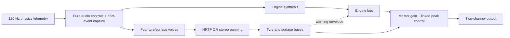

# Synthesized driving audio — research and implementation plan

Prepared 26 October 2026. **Status: researched proposal; audio implementation and
listening validation are still pending.** This document covers the player's car
in the browser solo-driving experience.

The user confirmed that **headphones are the primary output** and that
**clear handling feedback takes priority over naturalism**, including deliberately
different front/rear tyre timbres. Those decisions are incorporated below.

## Recommended result

Build a small procedural Web Audio system with an RPM-driven engine voice and
four independently controlled tyre voices. Keep a quiet idle rumble, increase
engine brightness and level with engine effort, and make interrupted power during
a gear change audible. Each tyre should progress from a gentle warning scrub
near peak grip into sustained slip noise. Preserve which wheel generated it.

Use headphone HRTF spatialization plus a learned front/rear timbre distinction.
Offer ordinary stereo panning with the same timbres as a fallback. Keep the
listening position attached to the driver/car, independently of the chase,
bonnet or overhead camera. Give tyre information priority in the mix.

This is a follow-up to the initial M8 presentation audio. A milestone number has
not been assigned. This planning task adds documentation only; it does not
declare the proposed system implemented or qualify its perceptual performance.

## 1. Repository evidence and integration boundary

The committed baseline inspected was development commit
`8ae14180ae2c932122a5a57e3b6be1e046c94c7f` (M7 integration).
The primary checkout also contained uncommitted M8 work on
`codex/m8-solo-sessions`. It was inspected read-only and was not copied into this
planning branch. In particular, engine/squeal and presentation settings below
describe that M8 working snapshot, not the committed M7 baseline.

During finalization, M8 landed on development at `97d30ad` (implementation
`50bbd27`). This planning branch was reconciled with that completed integration;
the two audio-file hashes below still matched. The final delta against integrated
M8 is documentation only. The earlier working-snapshot observations remain valid.

| Location | Evidence | Implication |
| --- | --- | --- |
| `src/audio/SurfaceAudio.ts` | Committed M7 has one aggregate noise/rumble path; the inspected M8 version adds one filtered sawtooth engine and one sine squeal. All feed the destination without wheel spatialization. | Replace the aggregate tyre path with four voices; preserve surface feedback and lifecycle behavior. |
| M8 `src/audio/feedback.ts` | Engine pitch is RPM/30; level follows raw throttle. Tyre scrub sums force/slip energy across all grounded wheels and is suppressed by chassis speed. | Left/right and axle identity are discarded. Stationary wheelspin is suppressed. There is no separate near-limit warning. |
| `src/vehicle/types.ts` | RPM, gear, shifting, engine/clutch torque; per-wheel ID, contact, load, speeds, angular speed, slip, forces, surface blends, ABS/TC flags. Physics steps at 120 Hz. | Most required inputs exist; no new tyre dynamics model is needed for the first audio prototype. |
| `src/vehicle/Tyre.ts` | Combined-slip demand reaches its model peak at normalized demand q = 1, then falls toward a sliding plateau. | Distinguish approaching the peak from sustained sliding; force magnitude alone cannot identify both sides of the peak. |
| `src/vehicle/Powertrain.ts` | A requested shift disengages clutch torque for about 0.16 s. Engine torque is not automatically cut for the whole shift. | Sound must follow RPM and shift state; RPM can flare while the clutch is open. A shift dip must not invent a lower RPM. |
| `src/physics/SuspensionRig.ts` | Traction control reduces throttle before the powertrain step. Final slip-ratio telemetry is recomputed without the resolved radius argument, falling back to 0.32 m. Reported forces can include loose-surface drag and auto-hold. | Use effective engine torque for load. Derive audio slip from resolved radius; treat force-based energy as a proxy, not measured tyre heat. |
| M8 `src/app/App.ts` | Audio updates once per animation frame, before that frame's physics steps. Pause, blur and hidden-page handling already silence it. | Publish fresh audio controls after stepping, retaining brief events across all steps; preserve lifecycle behavior. |
| `src/vehicle/coordinates.ts` and types | Project coordinates are +X left, +Y up, +Z forward. | Explicitly test coordinate conversion and channel polarity. |

For reproducibility, the inspected M8 audio files had these SHA-256 hashes:

- `SurfaceAudio.ts`: `18c238d07dabdbf0f2af970a132e5e95f9fda10885d2021a8e6f269622ff9047`
- `feedback.ts`: `009bbb22ecd1b0e8b6a2a6e1061ba2437d63a3b034d7fe183606eca1b2d4f4c0`

Recheck these integration points against completed M8 before implementation.
Do not transplant uncommitted M8 files, silently repair physics in an audio patch,
or change generation qualification hashes to imply new validation.

## 2. Research findings and design decisions

### Synthesis is appropriate for this scope

Baldan and colleagues describe procedural, physically informed combustion-engine
synthesis for interactive driving environments. Doerfler and Wyse describe an
RPM/torque-controlled harmonic-plus-noise model with resonators. These support
the general approach of combining periodic engine orders with filtered noise.
Our proposal uses hand-authored coefficients, a small voice budget and no
recorded engine samples, model training or dataset dependency.
Sources: [Baldan et al., 2015](https://air.iuav.it/retrieve/de164c2a-5461-60ee-e053-3a05fe0a7787/SIVE15_submission_4.pdf)
(indexed abstract consulted; direct PDF retrieval was blocked) and
[Doerfler and Wyse, 2026, sections II-B and I](https://arxiv.org/html/2603.07584v2).

### Tyre audio should communicate two different conditions

Senda et al.'s experiments associate squeal with sliding and self-excited tread
vibration; their measured onset was specific to their tested tyres and conditions.
It is not a universal grip-warning threshold. Our earlier warning scrub is an
intentional feedback cue tied to this game's tyre curve, followed by a more
tonal/rough slip sound. Do not copy the paper's sliding-speed threshold into the
game as a physical law.
Source: [Senda et al., Tire Squeal, 1984](https://www.jstage.jst.go.jp/article/jsme1958/27/231/27_231_2016/_article/-char/en).

A preliminary motorsport sonification study explored concurrent auditory
feedback and found encouraging results. It does not establish that this design
will improve lap times. We should test recognition and corrective response,
not assume a faster lap proves better feedback. Unlike its lateral-G proxy, we
can use the project's individual wheel states.
Source: [Powell and Lumsden, ICAD 2015](https://repository.gatech.edu/entities/publication/d11ca357-b36a-4349-984b-5f8664a527a0).

### Stereo can convey front/rear cues, but panning alone cannot

Left/right level and timing differences support lateral positioning.
Front and rear locations can share similar interaural differences; spectral
filtering by the head and outer ears helps disambiguate them. Wenzel et al.'s
study found substantial front/back confusion with nonindividualized HRTFs.
Therefore generic binaural processing is useful but cannot guarantee reliable
axle identification for every listener.
Source: [Wenzel et al., 1993](https://human-factors.arc.nasa.gov/publications/wenzel_1993_Localization_Head_Related.pdf)
(indexed paper text consulted; direct PDF retrieval timed out).

Web Audio offers inexpensive equal-power panning and HRTF convolution producing
two-channel output. HRTF is the proposed headphone renderer. A distinct axle
timbre is our additional, deliberately learned cue; its usefulness must be
measured in this game.
Sources: [W3C Web Audio spatialization](https://www.w3.org/TR/webaudio/#Spatialization)
and [MDN PannerNode panningModel](https://developer.mozilla.org/en-US/docs/Web/API/PannerNode/panningModel).

| Technique | Strength | Limitation | Decision |
| --- | --- | --- | --- |
| Equal-power stereo panning | Clear side separation; simple speaker fallback | Does not encode a reliable front/back location | Required fallback and diagnostic reference |
| Built-in HRTF per wheel | Direction-dependent filtering and binaural cues through stereo headphones | Listener/headphone variation; possible front/back reversals | Primary headphone mode, backed by timbre cues |
| Front/rear timbre and restrained modulation | Can identify axle even when spatial illusion is weak or collapsed to mono | Learned mapping; can be masked or confused with severity | Enabled by default, with adjustable strength |
| Artificial delay or phase inversion alone | Cheap widening effects | Does not solve front/back ambiguity; may damage mono compatibility | Do not use as the axle code |
| Personalized HRTFs, tracked head motion or speaker crosstalk cancellation | Could improve spatial realism in an appropriate setup | Calibration, hardware, seating and implementation requirements | Defer until the simpler method is tested |

Speaker playback mixes the two outputs acoustically at both ears, so do not
promise headphone-like rear externalization there. The fallback still provides
side and axle information using panning and timbre. Camera motion is not measured
head motion and must not be treated as head tracking.

## 3. Engine voice

Use RPM for pitch and engine effort for loudness/brightness. Road speed alone
cannot represent neutral revving, clutch release or wheelspin.

Start with three layers:

1. **Combustion body:** a band-limited periodic waveform with an uneven pulse
   character, lower harmonics and mild cycle variation for idle rumble.
2. **Loaded growl:** brighter harmonics/resonance that increase with positive
   engine torque and transmitted drive load.
3. **Mechanical/breath texture:** low-level filtered, synthesized noise to keep
   the result from sounding like a single musical oscillator.

A four-stroke design has a cycle frequency of RPM/120; with N evenly spaced
firings per cycle, the firing rate is RPM × N / 120. For a virtual four-cylinder
profile, 1,000 RPM gives roughly 33 Hz firing and 6,000 RPM gives 200 Hz.
Retain audible upper harmonics so idle is recognizable on modest headphones.
Cylinder count here is a **sound-design parameter**: the current car schema does
not simulate cylinders.

Use native `PeriodicWave`/oscillator and filter nodes first. Crossfade a small
number of coherent low/high-load waveforms; keep phase continuous and smooth
frequency/gain changes. If the prototype needs custom pulse timing or continuous
noise generation beyond the native graph, evaluate an AudioWorklet in step A0.

| Driving condition | Proposed response |
| --- | --- |
| Idle | Quiet, uneven rumble; low load does not mean silence |
| Accelerating under load | Rising pitch with RPM; increasing brightness and level with effective torque/load |
| Lift-off/coast | Level/brightness reduce quickly while pitch follows actual RPM decay |
| Upshift | Short load-layer reduction while shifting/clutch is disengaged; lower pitch only when actual RPM settles lower |
| Downshift | Brief load interruption, then the actual RPM increase; do not force every gear change to lower pitch |
| Neutral/revving | Pitch follows engine RPM even while the chassis is stationary; smaller transmitted-load layer |
| TC or limiter intervention | Audible reduction/roughness follows actual torque intervention; no randomly invented cut-outs |
| Reverse | Engine remains RPM-driven; reverse does not swap wheel channels |

Normalize engine effort using `engineTorqueAtRpm` and the effective
`powertrain.engineTorque`, with bounded positive clutch torque as a separate
drive-load term. Raw pedal position can add a small intake accent but must not
override an actual TC torque reduction. Retain an overrun texture without treating
negative clutch torque as full positive acceleration.

Initial audition values: load-layer shift attenuation of roughly 6–10 dB,
10–25 ms attack and 60–120 ms recovery; RPM smoothing around 15–30 ms.
These are tuning proposals, not validated constants. Keep the lower engine body
audible through a shift, and do not conceal a real rev flare with a fabricated
RPM ramp.

Start with three light sound profiles (small/buzzy, smooth/sport, deep/rumbling),
selected deterministically from car family/seed without altering mechanics.
Keep tyre axle identity consistent across every profile. Store a separate audio
profile version so cosmetic sound changes do not invalidate physics sessions.

## 4. Per-wheel tyre control and synthesis

### Extract useful, honest control signals

Create a pure adapter receiving telemetry, setup and the resolved car dimensions.
For each wheel, using angular speed omega, radius r and local contact speeds:

```text
vSlipLong = omega * r - vLong
slipRatioAudio = vSlipLong / max(abs(vLong), abs(omega * r), 1.5)

qLong = abs(slipRatioAudio) / longitudinalPeak
qLat  = abs(tan(slipAngle)) / tan(lateralPeak)
q     = hypot(qLong, qLat)

vSlip = hypot(vSlipLong, vLat)
scrubPowerProxy = abs(Fx * vSlipLong) + abs(Fy * vLat)
```

Guard non-finite values, validate positive peak parameters and bound audio
controls. q is normalized **model slip demand**, not a measured percentage of
grip remaining. The force solver uses intermediate/predicted states and relaxation,
so final telemetry q is an audio estimate of the curve region.

Use the resolved radius in the adapter instead of trusting the final reported
slip ratio. This avoids changing dynamics in the initial audio work. If telemetry
is subsequently corrected in the physics module, qualify that change separately
and review its compatibility fingerprint.

The power proxy controls texture/intensity; it is not exact dissipated heat.
Final forces include other contributions, and speed/radius states may follow
solver corrections. If exact force utilization is needed later, expose pure
tyre force and grip capacity from the solver rather than inferring them from
mixed final force telemetry.

### Separate proximity to the limit from sliding intensity

Use two overlapping envelopes, not one threshold or one global drift angle:

- **Warning scrub:** fade in around q = 0.65, becoming clear near q = 0.95.
  Require grounded contact, meaningful load and motion. This should be audible
  before the model reaches q = 1.
- **Sustained slip:** blend in around q = 0.95–1.2, increasing with relative
  sliding speed and the bounded energy proxy. Keep it active beyond the peak
  even if useful tyre force has fallen.
- Fade out smoothly when grip returns. Suggested activity hysteresis is about
  0.05 in q, with 10–20 ms attack and 80–140 ms release. Contact loss needs a much
  shorter fade; an airborne wheel must not keep squealing.
- Use wheel-relative sliding speed as well as road motion. A stationary burnout
  must be audible; a stopped, held car or an unloaded spinning wheel must not.
- Load-weight the warning so a lightly loaded inside wheel does not dominate
  the loaded outside wheel. Compress the sliding-intensity range rather than
  scaling it linearly across light/heavy cars. Avoid multiplying the same load
  contribution into the energy layer twice.
- Preserve four independent envelopes. A straight-line lock-up, driven-wheel
  spin, front washout and rear slide must retain their real wheel distribution.

These numbers are prototype settings. Tune from captured traces and listening;
do not present them as experimentally measured real-tyre squeal thresholds.

### Make each tyre voice readable

Use independent seeded filtered noise with a small resonant/tonal component.
Keep broad spectral content alongside the squeal; one pure sine is a poor carrier
for rich spatial filtering.

| Condition | Texture | Primary driver |
| --- | --- | --- |
| Rolling with grip | Very quiet road hiss | Contact speed, load and surface roughness |
| Approaching peak demand | Soft, rising scrub | q and meaningful contact/motion |
| Sustained tarmac slip | Stronger noisy squeal with modest pitch movement | q, relative sliding speed and energy proxy |
| Lock-up | Steady scrape/squeal; preserve affected wheel | Longitudinal slip and braking state |
| Wheelspin | Rougher driven-wheel squeal | Longitudinal slip and drive state |
| Kerb | Short rumbly pulses tied to contact/motion | Surface blend and roughness |
| Gravel/sand/grass | Granular scrape/rustle; less tarmac tonal squeal | Surface blend, slip and contact speed |

Crossfade material blends rather than changing a surface sound instantly.
Keep a subtle axle signature on loose surfaces, where the asphalt squeal is
reduced. Use separate random streams so simultaneous wheels do not become four
copies of the same correlated waveform.

For axle identity, start with front tyres having a brighter, smoother
scrub/squeal and rear tyres having a lower, rougher texture with restrained
amplitude modulation. Audition overlapping resonance regions around
1.2–2.4 kHz for front and 0.6–1.2 kHz for rear, with broadband support.
Avoid permanently narrow filtering that removes useful spatial cues.

Hold the axle signature stable as intensity changes. Severity should mainly
change envelope, noise/tonal balance and roughness; it must not pitch a rear
voice into the front identity range. The chosen frequency bands and modulation
are authored cues, not claims about real front and rear tyres.

Front-axle activity is not automatically understeer: it might be front wheelspin
or braking. Rear activity is not automatically oversteer. Sound the underlying
wheel condition; avoid categorical handling diagnoses until steering/yaw context
supports them.

## 5. Spatial rendering and mixing

### Headphone mode: primary

Keep four mono tyre source chains until spatialization. Route each through its
own `PannerNode` with `panningModel = "HRTF"`. Begin with virtual directions around
front-left/right ±45 degrees and rear-left/right ±135 degrees, zero elevation,
equal reference distance and disabled distance rolloff for the player's tyres.
These are deliberately clear driver-relative quadrants, not surveyed microphone
locations. Normalize the car geometry into these directions so long wheelbases
do not make the rear tyres too quiet or too central.

Keep the listener fixed at a virtual central driver position facing forward.
Use wheel IDs for quadrant identity. For future geometric placement, project
world contacts into car-local space first. Mapping project-local coordinates
to a default Web Audio listener is `(x, y, z) -> (-x, y, -z)`:
project left becomes audio negative X, and project forward becomes audio
negative Z. Do not double-rotate the listener and sources.

Use positive distance, omnidirectional sources and matched gains; disable cone
attenuation. Wheel movement, banking, camera changes and reversing must not swap
or unexpectedly bury a quadrant. Keep the engine largely central so it leaves
room for side-specific tyre cues.

Each HRTF source normally reaches **both** output channels with different
filtering/timing/levels. Left tyres should be heard predominantly on the left,
but hard routing to one ear is incompatible with preserving those binaural cues.
Provide a strict left/right routing diagnostic so channel separation is easy to
verify.

### Stereo mode and accessibility

Use a `StereoPannerNode` per mono tyre with a starting pan of about ±0.75.
Preserve front/rear timbres. Offer stereo width and a channel-check control,
with a fully separated left/right test. Headphone mode and ordinary panning are
alternative paths: do not pan an already binaural output a second time.

Provide an explicitly selected mono mode and an independent tyre level control.
Mono cannot preserve side localization, but the axle signatures and slip
intensity should survive. Avoid phase inversion or a Haas-delay trick as the
core wheel code. Offer a softer squeal character that retains the axle contrast.

### Protect the informative sounds

Keep engine, tyres and surface/impact effects on separate buses. Begin with a
gentle, linked 2–4 dB engine-bus reduction when strong tyre warnings occur. Apply
the same gain to both sides so ducking does not move the engine image. Prefer
spectral space and restrained levels to severe full-mix compression.

Reserve headroom for simultaneous four-wheel slip and impacts. Use a final
stereo-linked peak control stage if needed, with its delay measured. A
`DynamicsCompressorNode` is not by itself a promise of a brick-wall true-peak
ceiling; verify rendered samples and, where measured, reconstructed peaks.
Use gradual mute/resume ramps and bounded gains.

Expose: sound enable, master/engine/tyre/surface levels, Headphones or Stereo
output, axle-cue strength, and a short FL/FR/RL/RR demonstration. Advanced
controls can contain stereo width, mono and softer squeal. The default is
Headphones with clear axle cues, per the user's answers.

## 6. Runtime architecture



Proposed modules:

| Module | Responsibility |
| --- | --- |
| `audio/AudioControls.ts` | Pure per-wheel/engine control extraction; radius normalization; finite-value guards; envelopes |
| `audio/VehicleAudio.ts` | AudioContext lifecycle, graph ownership, updates, mute/suspend/dispose |
| `audio/EngineVoice.ts` | Periodic/noise engine layers and shift/load behavior |
| `audio/TyreVoice.ts` | Four bounded tyre/surface source chains |
| `audio/SpatialAudio.ts` | Headphone/stereo routing, quadrant mapping and calibration |
| `audio/settings.ts`, `audio/profiles.ts` | Versioned user settings and cosmetic car profiles |
| `diagnostics/AudioLab.ts` | Scripted states, telemetry playback, quadrant audition and measurement |
| Optional `audio/worklets/vehicle-processor.ts` | Only custom sample processing justified by the prototype |

Keep M8's shared visual `drivingFeedback` behavior intact when separating audio.
Do not change skid/smoke triggers just because tyre warning thresholds move.
Initially retain `SurfaceAudio` as a thin integration facade or replace its call
sites together so two audio graphs cannot play simultaneously.

Native nodes are the first implementation choice: only a handful of voices are
required. AudioWorklet is available for custom processing on the audio rendering
thread; avoid deprecated main-thread ScriptProcessor audio. If used, preallocate
DSP state, use the actual block length/sample rate, avoid per-block allocation,
and send bounded low-rate controls rather than streaming generated PCM.
Sources: [MDN AudioWorklet](https://developer.mozilla.org/en-US/docs/Web/API/AudioWorklet)
and [Chrome Audio Worklet design guidance](https://developer.chrome.com/blog/audio-worklet-design-pattern).

Collect control state after each physics step, retain short shift/contact/slip
events, and publish the latest state after the frame's physics loop. Keep event
history bounded and discard stale/reset events. Do not queue seconds of old
physics catch-up as future sound. Use the audio clock for ramps, with a resettable
simulation-time mapping; do not pitch the engine from render delta.

Smooth controls on the audio timeline rather than abruptly assigning gains.
Use one context, create it from a user gesture, support interrupted/suspended
contexts, and surface a recoverable enable failure.
[MDN Web Audio best practices](https://developer.mozilla.org/en-US/docs/Web/API/Web_Audio_API/Best_practices)
and [W3C parameter transitions](https://www.w3.org/TR/webaudio/#AudioParam).

On pause, hidden page, blur, reset, car/track replacement or teardown: cancel
obsolete events, fade the graph, clear envelope history and safely suspend or
dispose as appropriate. A stale-input watchdog should fade sustained sound when
updates stop; it must not depend solely on a main-thread timeout that can itself
stall. Use scheduled native fades, or worklet-side control age if a worklet is
adopted. Resume only with current telemetry. No accumulating nodes/listeners on
repeated toggles or track changes.

Request `latencyHint: "interactive"` without assuming it is honored. Record
`baseLatency` and `outputLatency` when present; these describe parts of the
pipeline and are not a measured action-to-ear delay. Wireless output can add
device-dependent delay. Report wired and wireless results separately.
Sources: [baseLatency](https://developer.mozilla.org/en-US/docs/Web/API/AudioContext/baseLatency)
and [outputLatency](https://developer.mozilla.org/en-US/docs/Web/API/AudioContext/outputLatency).

No additional audio library is needed initially. Worklet assets, if adopted,
must load through Vite in both development and production under HTTPS/localhost.
Keep a native-node fallback if worklet initialization fails.

## 7. Implementation sequence and decision gates

| Step | Deliverable | Exit condition |
| --- | --- | --- |
| A0 — Baseline and audition harness | Reinspect integrated M8; scripted telemetry playback and four-quadrant source controls; compare native graph and any justified worklet spike | Correct side mapping, stable lifecycle and controllable examples; choose the simpler renderer that meets needs |
| A1 — Tyre control | Four independent warning/slip envelopes using resolved radius and combined-slip demand; surface blending | Trace-backed warning before the model peak, audible stationary wheelspin, silent airborne/stopped contact |
| A2 — Engine voice | Idle/load/overrun layers, telemetry-driven shifts and a few cosmetic profiles | Idle, pull, lift-off, upshift, downshift, neutral and TC examples are recognizable |
| A3 — Spatial mix | HRTF plus axle timbres; stereo/mono fallback; tyre-priority mix and calibration | Listening comparison demonstrates side and axle identification with the engine on |
| A4 — Game integration | Settings, workbench control, pause/reset/disposal and source-matching diagnostics | Works in live sessions and production build without regressing M8 lifecycle |
| A5 — Qualification | Functional tests, offline renders, browser performance and human listening record | Gates below met or explicit limitations documented; push implementation branch and integrate development |

A1 takes priority because useful grip feedback is the principal missing behavior.
A0/A3 should settle whether the proposed axle timbres are distinguishable before
spending time on many engine personalities. Full combustion acoustics, sampled
sound libraries, custom HRTF datasets, environmental reverb/occlusion, Doppler,
AI-grid sound and music are outside this first implementation.

## 8. Validation and acceptance

All values below are **proposed acceptance targets**, not achieved measurements.

### Functional and rendered-audio checks

Test behavior rather than a particular node count or copy of the formulas:

- Each quadrant alone; both fronts, both rears, one side and diagonal pairs.
  Verify no left/right reversal in forward/reverse, camera changes or car yaw.
- A gradual combined-slip sweep through the model peak; warning precedes
  sustained slip and sliding sound does not disappear when tyre force drops.
- Loaded/unloaded and airborne wheels; stop/auto-hold, stationary burnout,
  brake lock, handbrake, ABS and TC; generated wheel radii at both range ends.
- Same RPM at low/high effective load; idle and neutral; up/down shifts; shift
  events spanning several physics steps in one render frame.
- All materials and mixed contacts; opposing wheel conditions must remain
  distinct. Off-road effects must not drown out near-limit tarmac feedback.
- NaN/invalid input, reset, pause/blur/hidden tab, device interruption, repeated
  toggle/rebuild, missing worklet and missing optional latency properties.
- Offline renders at 44.1 and 48 kHz: finite samples, bounded peaks, smooth
  transitions, predictable pitch tracking and no strong aliasing artifacts.
  Use spectral/RMS tolerances, not bit-identical HRTF snapshots across browsers.
- Mono fold-down: no material cancellation; front/rear timbre remains useful.
  Do not claim mono preserves left/right information.

### Listening gate

Provide short labeled practice examples, then randomize at least 32 single-wheel
trials per mode, balanced across all four wheels. Compare ordinary panning,
HRTF-only, and HRTF plus axle timbre; use the same source levels and matched
perceived loudness. Include small level variation so listeners cannot solve
front/rear solely by loudness.

Aim for at least **90% left/right** and **80% front/rear** identification with
engine audio present for the primary user on their usual headphones. Report
counts and a confusion matrix, not just a rounded percentage. Start with the
primary user; a small additional listener group would test generality, but a
single user's pass must be labeled as such.

Then test simultaneous front/rear activity and one dominant slipping wheel
under a loaded engine. Record axle recognition, time to recognize the event,
corrections and comfort in matched driving scenarios. Do not extrapolate isolated
four-corner success to reliable identification of four simultaneous equal sounds.

Compare at least two headphone types if available, stereo speakers, and a
15-minute driving session for fatigue/masking. If HRTF hurts recognition for a
listener, prefer the stereo-plus-timbre mode. If axle classification fails,
adjust timbre/modulation and training rather than merely increasing volume.
Lap time is secondary; perception and controllability are the primary gates.

### Performance and evidence

- Maintain the project's 1080p/60 fps target on the named reference machine.
  Initial budget: audio control work adds at most 0.5 ms at p95 per frame;
  confirm with paired audio-on/off captures.
- Profile the complete audio render graph, not just JavaScript update time.
  Target comfortably below its device render-block deadline and record
  underruns/glitches using available browser diagnostics. Run at least 20 minutes
  with four-wheel slip, engine load and representative generation/session work.
- Aim for graph response within about 30 ms of receiving a control update;
  measure the onset convention explicitly. Aim for action-to-ear response below
  80 ms on the reference wired setup if a loopback measurement is available.
  Otherwise report that end-to-end latency is unmeasured.
- Record browser/OS, audio device/connection, sample rate, settings, source
  commit/hash, scenarios, trace IDs, latency scope, performance and listening
  results. No broad browser claim from one Chromium session; smoke-test Firefox
  and Safari on available hardware or record them as untested.

At implementation completion run
`npm test -- --maxWorkers=2` and `npm run build`. Since this integrates M8
session/presentation, also follow `qualify:m8`, `qualify:m8:stress`, visible
session/browser checks and `report:m8` from the then-current M8 instructions.
Restart the development server after any physics/race edits. Add an audio report
such as `docs/research/audio-qualification.json`; do not create passing evidence
until it has actually been measured.

Audio-only synthesis/settings do not require rerunning historical car/track
construction campaigns. Any scope expansion into construction or physics must
be evaluated under the repository's relevant qualification rules.

## 9. Resolved choices and remaining listening questions

Resolved with the user:

- Main output: headphones.
- Clear driving feedback has priority over naturalism.
- Deliberate front/rear timbre differences are acceptable.

Working defaults needing no further clarification to finish this plan:

- Driver-relative sound in all driving cameras.
- Explicit sound enable; persistent level/mode preferences.
- Near-limit warning enabled; quieter idle and engine ducking during strong slip.
- Three modest engine personalities; no car mechanics/schema change for audio.
- Separate audio settings/profile version; preserve M8 session identity.

The first audition should settle preferred engine character, comfortable squeal
brightness, and how strong the axle signature needs to be on the user's actual
headphones. These are listening decisions; written descriptions cannot validate
them. There is no remaining blocking product question for implementation planning.

## 10. Delivery policy and present scope

This research uses `codex/audio-system-plan`, branched from fast-forwarded
`development`, and follows [the release workflow](../workflow.md). Integrate the
completed documentation into remote development; leave main and the primary
checkout's uncommitted M8 work untouched.

An implementation request should start a new audio implementation branch from
then-current development, after reconciling M8 integration. Complete the checks,
publish source-matching evidence, commit/push that branch, merge and push
development for testing. Promotion to main remains a separate release request.

Planning validation initially passed 216 tests on the M7-based branch. After
reconciling completed M8, **237 tests passed across 15 files** using
`npm test -- --maxWorkers=2`; `npm run build` passed strict TypeScript and
production compilation (the existing large-chunk warning remains). All **68
relative Markdown links** across the four changed documents resolved;
`git diff --check` passed. The final change against integrated M8 is documentation
only. These regression/build checks do not establish sound quality or perception
of this unimplemented design. Existing M8 and generation qualification reports
retain their original source hashes; none was rewritten by this planning task.
