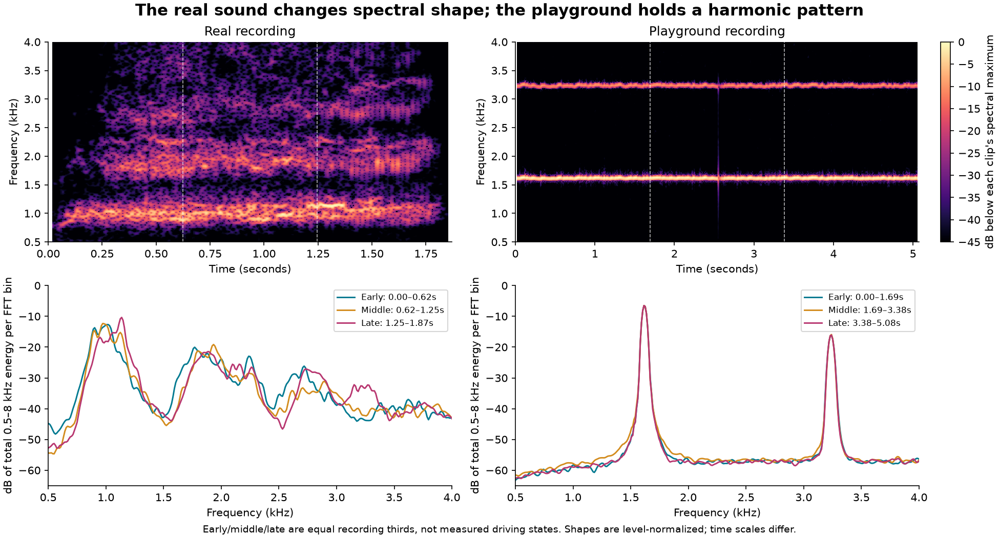
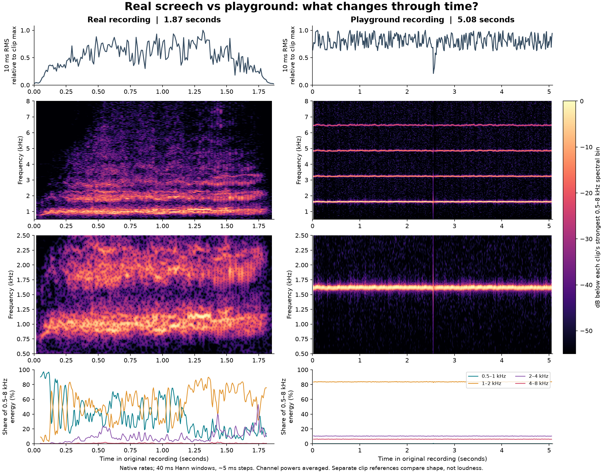

# Tyre screech: reference recording versus playground

26 October 2026. Research following rejection of the second, tonal tyre candidate
(`cff62ae`, integrated at `bfbf475`). **Another source implementation is not
approved.** The engine direction remains accepted. This report updates the
[timbre plan](audio-timbre.md); it does not change the playground or production DSP.

## Finding

The supplied reference has a lower dominant frequency region, broader spectral
bands and substantial changes in their relative strengths through time. The
playground recording has an almost stationary harmonic series with amplitude
flutter. Adding harmonics addressed the earlier whistle only superficially:
it retained the same underlying problem of one tone whose shape barely changes.

The user's distinction between changing **strength** and changing **nature of
the sound** is supported by the recordings. This is not a request for louder
white noise. The reference still contains strong pitched structure, but that
structure is spread, irregular and evolving rather than four isolated, steady
lines. Lowering our pitch alone would leave those other differences intact.



Top: bright regions show where energy lies over time. Bottom: each recording's
three equal-duration sections are normalized to equal energy in 0.5–8 kHz, so
their differences cannot be explained by volume alone. The synthetic curves
almost overlap. Time axes differ because the original clips have different
durations. The thirds describe positions in the recordings, not measured
onset/slide/recovery vehicle states.

## What was measured

| Measurement | Good screech, supplied real recording | Bad screech, supplied playground recording |
| --- | --- | --- |
| File | `good screech (real recording).wav` | `bad screech.wav` |
| Format | 48 kHz, 16-bit stereo; 1.8703 s | 44.1 kHz, 16-bit stereo; 5.0759 s |
| Dominant peak, 10th–90th percentile of active frames, search 0.5–4 kHz | About 0.90–1.13 kHz | About 1.615–1.626 kHz; close to the FFT bin spacing |
| Whole-clip average spectrum | Strong regions near 1 kHz and 1.8–2.3 kHz, with further weaker structure | Narrow lines near 1.62, 3.24, 4.86 and 6.47 kHz |
| Energy inside five narrow, fixed peak neighbourhoods, 0.5–8 kHz | 56.2% | 98.1% |
| Median spectral centre, early → middle → late, 0.5–8 kHz | 1.178 → 1.249 → 1.404 kHz | 2.004 → 2.004 → 2.004 kHz |
| Energy below 1 kHz as a share of 0.5–8 kHz, early → middle → late | 44.3% → 43.5% → 14.7% | About 0.004–0.005% throughout |

The peak-neighbourhood measurement selects five separated peaks from the average
spectrum and sums energy within ±40 Hz of them. Its complement includes moving
tones, additional partials, spectral skirts and noise. **It is not a measured
noise percentage.** These are descriptive measurements, not a realism score or
required tuning targets. A frequency band boundary at 1 kHz also makes the
below-1-kHz fraction sensitive to energy moving across that boundary.

The reference starts with a lower band emerging, develops upper bands and
fluctuating structure, then favours a higher part of the dominant region late
in the excerpt. It does not perform one smooth pitch sweep: regions coexist,
change prominence and broaden. The ending also falls in level, so a whole-clip
average spectrum would hide useful changes. The synthetic excerpt is already
active at its start and stays active at its end; it cannot establish how the
playground's separate onset/recovery fixtures sound.

### Temporal fluctuation versus spectral evolution

Both files have volume fluctuation. Over the same **0.4–1.4 second interior
window** in each clip, 10 ms RMS envelopes of the 0.5–8 kHz band have relative
standard deviations of 0.238 (real) and 0.125 (playground). After removing slow
envelope variations with a 5 Hz high-pass, the ripple RMS relative to mean level
is 0.200 versus 0.106. The reference has stronger short-time level variation in
this excerpt; the synthetic signal is not missing amplitude modulation entirely.
These descriptors are not psychoacoustic roughness values or estimates of a
physical stick/slip repetition rate.

More revealingly, normalize every short-time spectrum to unit energy before
comparing consecutive frames. The median total-variation distance is **0.185
versus 0.0287**, about 6.5 times larger in the real excerpt. This measures changing
spectral distribution, including fluctuation of noise-like energy, rather than
loudness. The equal-duration excerpt also retains the concentration difference:
59.4% versus 98.0% in the fixed peak neighbourhoods. Thus the full-clip result
does not depend only on the reference having fades or being shorter.



## Why the current model cannot reach this by tuning alone

`TonalTyre` in [the worklet](../../public/audio/playground-voices.js) derives all
five harmonics from one continuous phase. Their relative amplitudes are fixed
by `edge`; `roughness` supplies shared amplitude flutter and small shared pitch
variation. Slip primarily changes a common activity envelope. With settings held
constant, the normalized harmonic pattern is consequently almost fixed.

The WAV is consistent with this structure, but the user's exact saved preset
and capture route are not supplied; the analysis does not pretend to recover
those settings. Current default front-wheel pitch is about 1.79 kHz, whereas the
provided tuned recording is around 1.62 kHz. The reference's dominant region is
lower than either. The relevant target is this reference's character, not an
assumption that squeal must be at the highest available pitch.

The first candidate produced broad filtered noise without a convincing pitched
core. The second supplies an excessively coherent harmonic core with almost no
independent spectral evolution. Neither source spans the reference's combination
of tonal structure and changing, concentrated roughness.

## What the acoustic research adds

Senda et al.'s tyre/vehicle/rubber experiments associate squeal with self-excited
tread vibration during sliding. That supports retaining pitched structure;
plain broadband friction noise is insufficient. Their reported conditions are
specific to their experiments, not universal onset thresholds for the game.
[Tire Squeal, 1984](https://www.jstage.jst.go.jp/article/jsme1958/27/231/27_231_2016/_article/-char/en).

Tan Li's NOISE-CON 2019 study measured eleven tyres during braking/cornering.
Its spectrograms show frequency changing during individual events; one braking
example rises from 670 to 850 Hz while speed falls. Different tyres and manoeuvres
have different frequency ranges. The proposed explanations involving tread
stiffness and friction changes are hypotheses that the paper says need further
verification. These observations support time-dependent character and caution
against tying pitch directly to wheel speed. They do not establish the cause of
the motion in the user's recording.
[Tire Braking/Cornering Noise Analysis: Stick/Slip Mechanism, pp. 4–6 and 10](https://www.researchgate.net/profile/Tan_Li8/publication/338375049_Tire_BrakingCornering_Noise_Analysis_StickSlip_Mechanism/links/5e0f8b6a92851c8364b007e1/Tire-Braking-Cornering-Noise-Analysis-Stick-Slip-Mechanism.pdf).

For synthesis, Serra and Smith's spectral modelling approach separates tracked
sinusoidal frequency/amplitude trajectories from a time-varying filtered
stochastic component. That provides a relevant analysis/reconstruction method:
measure how pitched structure and the residual change, rather than assuming
fixed harmonics plus unchanging hiss. Applying it to this tyre target is our
proposed experiment, not an already validated tyre model.
[Spectral Modeling Synthesis, 1990, author-group description](https://mtg.upf.edu/node/251).

## Revised proposal — pending approval

### 1. Reconstruct one short phrase before another playground backend

Use the reference as an acoustic target in a small offline analysis/reconstruction
experiment. First track multiple spectral ridges through the phrase, preserving
their individual frequency and strength trajectories rather than snapping every
peak to one harmonic grid. Estimate the evolving residual only after accounting
for those tracks; a broad ridge must not automatically be labelled white noise.

Prepare a short comparison of the original reference, reconstruction and the
current synthetic clip at a fixed, comfortable comparison level. A useful
diagnostic version can freeze the reconstruction's spectral shape while keeping
its overall envelope: the difference isolates what temporal timbre contributes.
This is a proposed future audible experiment, not work performed in this report.
It should have one prepared candidate, not another hunt through sliders.

Use the supplied WAV as a local reference. Do not bundle it or its reconstruction
as a game asset. If sampling is preferred for the eventual voice, select material
with appropriate reuse rights at that stage. No recording has been added to the
repository in this pass.

### 2. Choose a controllable representation only after that listen

The candidate representation is several evolving resonant/partial families plus
spectrally concentrated, time-varying roughness. Relative family strengths,
frequency spread, partial strength and residual colour must be able to change
independently of total gain. Preserve useful harmonic relationships where the
analysis supports them; do not replace one tone with several unrelated notes.
Any independent variation needs bounds and some correlation to avoid chorus.

If a compact reconstruction retains the desired identity, reduce it to authored
trajectories and a modest real-time source. If it loses the identity, compare a
recording-based source before spending more time inventing oscillators. The two
failed tyre passes are reason to make that decision from a concrete short sound,
not a promise of realism from a more complicated formula.

### 3. Make event history control character as well as level

After source acceptance, map the existing wheel telemetry into an audio state
with memory: entry into sliding, continuing slide, and recovery. The same slip
value during entry and recovery need not produce the same spectral distribution.
Use hysteresis and smooth transitions so threshold jitter does not restart the
sound. Sustained sliding must continue indefinitely rather than reach the end
of a recorded one-shot. Contact loss must still silence it promptly.

| Existing information | Proposed use, subject to source acceptance |
| --- | --- |
| Contact, load and surface | Eligibility, level and surface family |
| Combined-slip demand and relative sliding speed | Entry/continuation/recovery state and excitation |
| Force-times-sliding proxy | Bounded level contribution, separate from spectral character |
| Recent excitation and its rise/fall | Smooth evolution of spectral balance, spread and roughness; audio history, not a claim to simulate rubber temperature |
| Actual rapid slip changes | Event modulation with phase continuity; no generic fixed vibrato |

An event's state must respond to what the wheel does, not automatically march
through early/middle/late thirds on a timer. The supplied clip has no driving
telemetry; it cannot determine thresholds or prove which physical event caused
each spectral change. Establish the voice with authored trajectories first,
then use a short existing-control replay for this mapping when approved.

Keep the accepted engine, versioned presets, four-wheel routing and validated
runtime foundation. No physics rewrite or new channel qualification is implied.
Any later DSP change gets short relevant checks; listening decides timbre. The
full suite and 20-minute endurance run are not part of this research pass.

## Reproduction and limits

Run [the analysis script](../../scripts/analyze-tyre-recordings.py) with Python
and `numpy`, `scipy`, `matplotlib` installed. It reads the originals and writes
only the two figures and [measurement JSON](tyre-recordings/tyre-recordings-analysis.json):

```powershell
python scripts/analyze-tyre-recordings.py --good "C:/Users/user/Documents/good screech (real recording).wav" --bad "C:/Users/user/Documents/bad screech.wav" --out docs/research/tyre-recordings
```

The JSON records file SHA-256 hashes, analysis-script hash, formats, versions,
parameters, full-clip measurements, equal recording thirds and matched interior
windows. The 40 ms Hann windows advance about 5 ms; a 4096-point FFT supplies
approximately 11 Hz bins but does not overcome the window's frequency resolution.
Overlapping frames are not independent experimental observations. Spectral
statistics omit frames more than 25 dB below that clip's maximum 0.5–8 kHz energy.
Plots average channel powers, not the stereo samples; there is no phase-cancelling
mono downmix. The two channels are almost identical in each file.

The reference's whole-file RMS is about 3 dB higher, and its peak-to-RMS ratio is
larger. These are file levels, not calibrated acoustic loudness. Spectral shape
comparisons remove overall gain; the original WAVs are not normalized or edited.
Neither has samples at the PCM limits, which does not establish absence of
earlier compression or processing.

Unknown recording position, multiple tyres, movement/Doppler, reflections,
microphone response and editing can contribute to the real clip. These two files
do not identify how much each contributes. In particular, visible frequency
bands are not proof of individual wheel modes. The current analysis is waveform
and spectral measurement; the user's listening judgement remains the evidence
for which recording has the desired sound.

Validation for this research consists of successful decoding, finite generated
metrics, inspection of both figures, original-file hash preservation, local-link
checks and `git diff --check`. No app DSP, build, physics, routing or playback
code changed, so no application tests or endurance runs were performed.
