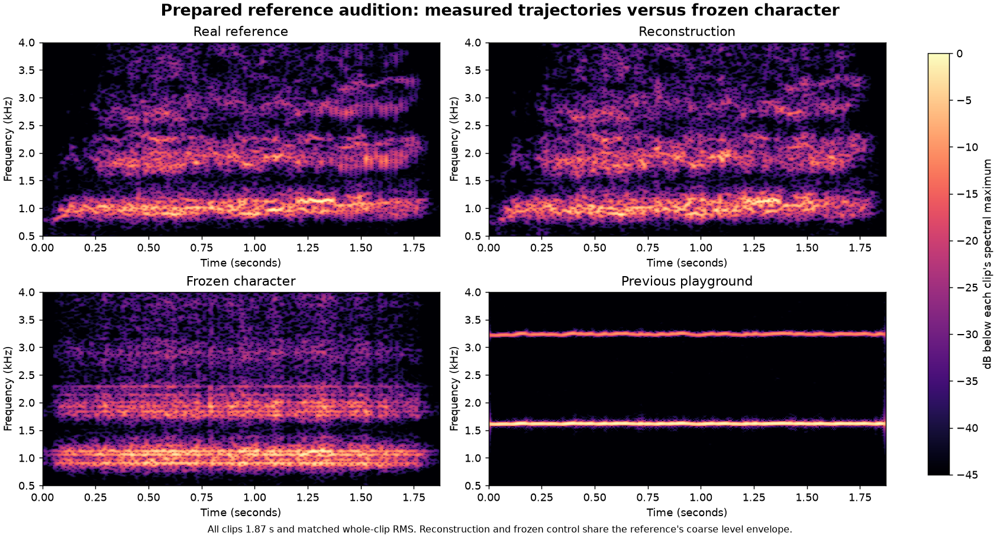

# Tyre reference reconstruction: ready for listening

**Historical experiment:** the owner requested removal of its source/comparison
recordings, player page and serving route before the audio release on 27 October
2026. The measurements and analysis below retain their original scope. Current
driving/playground sound uses the numerical model and fresh synthesis; see the
[cleanup record](audio-recording-cleanup.md).

26 October 2026. The user approved continuing the
[recording-informed proposal](tyre-recording-comparison.md) until the next hearing
step. That step is now prepared at **`/audio-reference.html`** on the development
server, also linked from the audio playground. The user has now accepted the
reconstruction as the tyre-screech direction: “yes perfectly”. The next approved
[live-control prototype](controlled-tyre-screech.md) is ready in the playground;
its dynamic timbre is the next hearing decision.

## The short comparison

Start with **Hear reference → reconstruction**, about four seconds including a
short gap. The optional **Hear all four** sequence takes about ten seconds.
Individual buttons replay each clip. There are no new tuning sliders to search.

| Clip | Purpose |
| --- | --- |
| Real reference | The supplied real screech, converted to mono and the shared comparison level. |
| Reconstruction | Independently rendered sinusoidal ridge trajectories plus freshly generated texture following an estimated spectral residual. |
| Frozen character | Freeze the mid-phrase partial frequencies/strengths and residual colour; preserve the coarse rise/fall in level. |
| Previous playground | A 1.87-second excerpt beginning 0.4 seconds into the supplied bad-screech recording, at the shared level. |

All four clips are 1.8703 seconds, 48 kHz mono PCM. Whole-clip RMS is matched to
−23 dBFS; the loudest peak is below −9 dBFS. The page adds a shared listening
volume, initially 75%, and a four-millisecond edge fade. It never changes levels
independently while comparing clips. Equal RMS does not guarantee equal perceived
loudness. Only one clip plays at a time; Stop and leaving/hiding the page stop
playback. Clips do not loop automatically.

## What was reconstructed

The [offline script](../../scripts/reconstruct-tyre-reference.py) analyses the
real reference in 2048-sample Hann windows with 240-sample steps at 48 kHz.
It locates up to 18 separated peaks per frame between 450 Hz and 7.2 kHz, links
nearby peaks without a harmonic grid, and retains tracks spanning at least 40 ms.
This phrase retains 251 ridge tracks over its duration, not 251 simultaneous
oscillators. The frozen midpoint has 12 active tracks.

Each track is rendered with interpolated amplitude and integrated frequency,
one initial phase and short birth/death fades. The renderer does not copy a
series of original waveform phases per frame. After subtracting the modelled
ridge power, a smoothed residual-power envelope shapes fresh seeded Gaussian
excitation. The residual discards the reference's phase. The result is an
analysis/reconstruction experiment, not playback of the original WAV under a
different label and not a new general-purpose tyre voice.

The frozen version holds the active partials and local residual colour around
0.935 seconds. Random texture still fluctuates. It is a useful diagnostic
comparison, not an experiment in which every detail except one scalar is
mathematically identical. Both generated versions follow a coarse RMS envelope
derived from the reference. Independent 10 ms boxcar-envelope correlations with
the reference are approximately 0.967 and 0.963, respectively; their fine texture
is not identical.



The reconstruction's median spectral centre in the recording's three thirds
is approximately **1.194 → 1.296 → 1.455 kHz**, versus the reference's
**1.177 → 1.248 → 1.416 kHz** using this script's analysis settings. The frozen
version stays near **1.215 → 1.226 → 1.230 kHz**. This confirms the prepared
files contain the intended spectral evolution/control difference. It does not
establish perceptual realism. Full parameters, source/output hashes and measured
scope are in [the render record](tyre-reconstruction.json). These settings differ
from the earlier comparison script, so use this run's reference measurements
when comparing its generated outputs.

## The hearing decision

1. Does the reconstruction retain the real screech's identity through its
   beginning, middle and ending, or introduce an obvious whistle, hiss, musical
   tone, graininess or warble?
2. Compared with the reconstruction, does freezing the character lose something
   important? This distinguishes the evolving phrase from a better static base.
3. Does this direction merit reducing the model to controllable spectral families,
   or should the next source comparison use recording-based material?

Stop at that decision. Event-history/slip mapping, another realtime backend,
vehicle profiles and production integration follow source acceptance. The
accepted pulse/exhaust engine, old tyre presets, wheel channels and proven
runtime remain the foundation. No additional listening campaign is required to
reach this step.

## Local files and reproduction

The source WAVs remain untouched in the user's Documents folder. Generated
reference-derived audio and the small manifest live only in ignored
`artifacts/tyre-reference/`. The development-only middleware serves those fixed
filenames and the later control-model JSON under `/__audio-reference/`; it cannot
browse arbitrary paths. No
recording or reconstruction is committed, copied into `public/`, or bundled
by the production build. A different checkout/machine must prepare its local
files before this page can play them. The page reports that condition clearly.

With Python, NumPy, SciPy and Matplotlib installed, from the repository root:

```powershell
python scripts/reconstruct-tyre-reference.py --good "C:/Users/user/Documents/good screech (real recording).wav" --bad "C:/Users/user/Documents/bad screech.wav"
```

This writes the four local WAVs and manifest, plus the committed measurement
record and figure. Run the normal development server and open
`/audio-reference.html`. No source recording is needed to build the app; the
reference audition's local-file service does not run during production builds.

## Targeted validation

- The generated PCM files decode, contain finite bounded samples, have matching
  durations and RMS levels within 0.01 dB, and retain headroom. Source WAV and
  output hashes were verified.
- The three focused middleware tests pass: fixed-file GET/HEAD, rejection of
  arbitrary/traversal paths, rejection of writes and graceful missing files.
- Strict TypeScript checking and the production build pass. The build contains
  no WAV files.
- The short browser check covers file loading, sequential comparison playback,
  individual playback and Stop. This is a playback/workflow check, not a claim
  that a person has accepted the sound.

No production voice, physics, spatial/channel or collector behavior changed.
The full regression suite, driving campaigns and endurance run were not rerun.
