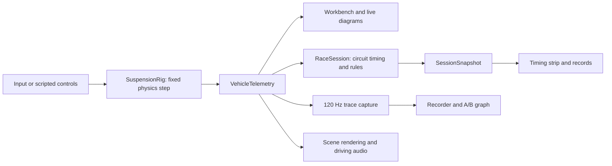

# UI analysis: a vehicle dynamics workbench

Prepared 27 October 2026. **Analysis only; no application changes.**

Audited source: `5e3c7ed666a058e22050110c260b3f686aac0f0c` on `development`
(v0.3.0 integration). Research branch: `codex/ui-workbench-analysis`.
The [repository workflow](../workflow.md) governs subsequent implementation.

## Recommendation

Preserve the existing technical appearance and make the working arrangement more
deliberate. The strongest product loop is **choose a car and condition, drive or
run a test, observe the response, adjust, compare, keep the result**. Its essential
tools already exist, but their prominence does not reflect that loop.

The immediate opportunity is to consolidate the three horizontal rows above the
scene, make the setup inspector's existing collapse function discoverable, and
add collapse to the existing live telemetry panel. Keep the telemetry diagrams,
backgrounds, typography and technical detail. Keep every manual generation option.

The image experiments changed several variables at once: typography, diagram
geometry, contrast, panel boundaries and layout. Their large outlined numerals
and isolated floating widgets weakened the shared measurement surface that makes
the original feel like an instrument. That is an assessment of those mockups,
not evidence that the current product needs less technical information. Future
layout studies should use the real components at their real CSS sizes.

### Scope and evidence

- Read the application shell, event routing, setup editing, telemetry/recording,
  garage/comparison, car/circuit authoring, library, session, input and relevant
  storage/model code. References below identify the important boundaries.
- Inspected the running app at `http://127.0.0.1:5173/`, including the setup toggle,
  response recorder and Garage / Compare. Measured DOM geometry at the browser's
  native **1841 x 1260 CSS-pixel** viewport. These are layout observations, not a
  controlled driving, performance or qualification campaign. A connected gamepad
  was reported; changing telemetry values were not treated as test results.
- Read the supplied *Gran Turismo Manual (PAL)*, especially the technique material
  beginning on PDF page 54, drivetrain sections on 56-59, tyres on 60-62, weight
  transfer/cornering on 63-71, lines on 72-74 and suspension/stabilisers/tyres on
  99-102. Visually checked rendered pages 60 and 100. The booklet is a teaching
  reference supplied by the owner; its scan and extracted text are not committed.
- Recommendations are proposals. The future category selector, explanations and
  looping demonstrations described by the owner are **not implementation scope**
  for this pass. No new image mockup is needed to settle the information hierarchy.

## 1. What the application already offers

“First-class” means easy to identify and reach in the current task. It does not
mean every field must remain permanently visible.

| Capability available now | Current home | Recommended prominence |
| --- | --- | --- |
| Active car, current tune, saved baseline, undo/redo, pending chassis edits | Setup inspector; some identity repeated beside the scene | First-class context. Keep identity and modified/pending state discoverable with the inspector closed. |
| Four reference cars and eleven procedural car families; layout and performance band | Reference dropdown; Car workshop | First-class car selection entry. Detailed construction remains an authoring view. |
| Car seeds, independent seed streams/locks, dimensions, body sections, paint/trim, packaging preview, physical acceptance and export | Car workshop | Full access on demand. Separate choosing a car from editing its construction. |
| Seven selectable environments: circuit, level pad, one-wheel bump, incline, bank, drive pad, split grip | Entire scene toolbar | First-class test-condition selector; a compact chooser can expose the same seven options. |
| Circuit test starts, reset, drop, roll and pitch impulses | Surface toolbar, circuit row and inspector | First-class repeatable testing, grouped coherently. Distinguish resetting the car from resetting its tune. |
| Five tuning tabs; live numeric/slider edits, field reset, basic/all settings, linked axles, independent corner overrides | Setup inspector | First-class while tuning. Keep the existing panel and give it an obvious local collapse/reopen control. |
| Roll, pitch, contact, wheel loads and travel; road/world reference | Live telemetry panel | First-class observation while tuning. Preserve the panel as-is when open; allow explicit collapse. |
| Per-wheel slip, slip angle, RPM, surface and load detail; force visualization | Tyres tab, row tooltips, scene camera controls | Important diagnostic detail. Link it clearly from observation/tuning; do not erase it as clutter. |
| Live 120 Hz recorder, last-20-second buffer, freeze/scrub, saved runs, export | Left rail chart icon; response overlay | First-class measurement entry, currently under-signalled by an icon. Detailed trace on demand. |
| Named setup library, import/export, matched launch/braking, steering-response and settling tests; two-run overlays | Garage / Compare modal | First-class comparison entry. Library management and experimental comparison deserve distinct sections within that destination. |
| Authored proving circuit, touring/GP generation and seven expanded venue families | Circuit workshop | First-class track selection entry. Keep detailed construction controls in the workshop. |
| Route alternatives, full/club/speedway variants, terrain/length/rhythm, banking, facilities, scenery, seeds, generation versions, validation and diagnostic previews | Circuit workshop | Retain all controls, arranged into recipe, venue, inspection and advanced/reproduction groups. |
| Saved circuits, search/favourites, exact accepted route/variant, import/export and recoverable trash | Circuit library | Normal track-selection path. Raw archives and migration actions are secondary. |
| Practice, time trial, sectors, delta, validity, keyed personal bests and compatible ghosts | Full session row; Session & records modal | Timing is first-class when driving timed laps. Rules, history and archive exchange belong in the session view. |
| Cameras, overview, speed/gear/RPM, assists/contact indicators, current corner and road metrics | Scene HUD and circuit row | Retain the current functional presentation. Gather camera choices together. Preserve corner type, elevation, grade and bank as useful learning context. |
| Sound mixer/listening tests, rendering quality/effects, camera settings, input remapping/gamepad calibration, help | Header, Session & records, rail and footer | A coherent settings/help destination; quick mute and pause remain directly accessible. |

Sources: [Workbench shell](../../src/workbench/Workbench.ts#L420),
[Car workshop](../../src/workbench/CarWorkshopPanel.ts#L46),
[Circuit workshop](../../src/workbench/CircuitGeneratorPanel.ts#L55),
[Garage](../../src/workbench/GaragePanel.ts#L40),
[Trace recorder](../../src/workbench/TracePanel.ts#L29),
[Sessions](../../src/workbench/SessionPanel.ts#L31),
[Circuit library](../../src/workbench/CircuitLibraryPanel.ts#L49).

## 2. Where the vertical space goes

The supplied crop shows three separate rows, but the complete application also
has a global header above them. The live browser measurements were:

| Region | Height in observed viewport | Purpose |
| --- | ---: | --- |
| Global app header | 72 px | Brand, workshops, pause, sound, save |
| Surface/test toolbar | 57 px | Seven environment buttons, drop, reset |
| Circuit context row | 76 px | Track identity, test start, overview/library/workshop, description |
| Session row | 100 px | Mode/message, splits, timer, delta, session actions |
| 3D scene | 705 px | Actual visible simulation |
| Live telemetry panel | 218 px | Three diagrams and datum control |
| Footer | 32 px | Runtime status, shortcuts, input state |
| Total | 1260 px | |

The three local rows cost **233 px**, and the scene begins **305 px** below the
top edge. The scene occupies roughly **56% of the available height** in this
particular viewport. This is a layout problem even before changing any font size.
The session and circuit rows devote full-width space to information that is
mostly static, sparse, or only relevant during one activity.

These are not universal pixel values: the stylesheet changes at width/height
breakpoints. For example, the circuit telemetry panel is reduced at short desktop
heights. The CSS also enlarges the inspector and instruments above 1600 px width.
See [base layout](../../src/style.css#L83),
[wide desktop rules](../../src/style.css#L1297),
[circuit row](../../src/style.css#L1805),
[session row](../../src/style.css#L2846), and
[short desktop rules](../../src/style.css#L3246).

### Proposed arrangement for the next pass

Keep the existing global header initially. Replace the **three local rows with
one compact working toolbar**, with a design target of roughly 48-56 px, subject
to an actual DOM prototype. This avoids making the first pass depend on fitting
every global and contextual action into one enormous horizontal menu.

| Toolbar area | Contents | Detail behind it |
| --- | --- | --- |
| Left: test context | Active environment and track; selected test start when space permits | Environment chooser with all seven options; start descriptions; track library/workshop |
| Center: current measurement | Lap/sector, timer and delta on the circuit; relevant test context on pads | Splits and reference information; session details |
| Right: current action | Practice/time-trial control, reset and tests entry | Drop/roll/pitch actions appropriate to context; session records |

Use an explicit compact validity/warning indicator in the toolbar, with the full
reason available by focus/click. A wrong-way, invalid-lap or pit warning must not
disappear into an overflow menu. Persistent instructional prose and repeated
“no personal best” messages do not need their own full-width rows. Test-start
descriptions can live in their chooser and appear when a start is selected.

With a 52 px working toolbar, the observed layout would reclaim **181 px** while
keeping the current header, footer and telemetry panel: the scene would be about
886 px tall. This is arithmetic on the measured layout, **not a measured new UI**.
A 28 px collapsed telemetry handle would reclaim another 190 px in this viewport.
The target handle sizes are proposals, not commitments or qualification results.

Keep the timer centered in the main working area, independently of asymmetric
left/right controls. Ensure the toolbar can shorten labels or reveal secondary
controls without wrapping back into multiple permanent rows at narrower desktop
widths. Do not solve the problem by reducing the already small labels further.

### Collapse behavior

- **Setup inspector:** collapse already exists. The left rail's slider icon
  toggles `inspector-collapsed`; there is no local collapse button in the inspector
  header. Add a local chevron, a visible reopening handle and an expanded state
  label. Preserve the selected tab, scroll position, draft edits and undo history.
- **Live telemetry:** currently has no collapse control. Keep the current three
  cards and datum control intact when expanded. Add a clear header toggle and
  compact reopening handle. Collapsing a view must not stop recording or physics.
- **Response recorder:** the chart icon opens a separate 300 px absolute overlay
  above the bottom of the working area. It covers the diagrams and some scene;
  it does not add another 300 px to the document flow. Name it “Recordings” or
  “Response recorder” to distinguish it from live telemetry. Unifying both into
  one bottom dock is a later option, not required for the first collapse pass.
- **Left side:** the audited build has a permanent narrow tool rail, not a
  collapsible drawer. Match its compact navigation character, but do not assume
  a left-drawer state/controller already exists.

Browser verification hid the 370 px inspector and increased scene width from
1399 to 1777 px. The extra 8 px comes from a CSS detail: the collapse selector
also changes the wide-screen rail from 72 to 64 px. Keep rail width stable in a
future layout change. [Toggle handlers](../../src/workbench/Workbench.ts#L603),
[collapse CSS](../../src/style.css#L1159),
[recorder overlay CSS](../../src/workbench/m6.css#L629).

## 3. Duplicate controls and confusing overlaps

| Current duplication/overlap | What the code actually does | Recommended treatment |
| --- | --- | --- |
| Car workshop in header and left rail | Both `car-workshop` controls open the same panel through `Workbench.onClick` | Choose one persistent navigation home; retain a contextual link from active-car information if useful. |
| Garage / Compare in header and rail | Same `garage` action and panel | One primary entry, labelled around saved setups and comparison. |
| Circuit workshop in rail and circuit row | Same `generator` action | Put workshop and library under the track/context entry; avoid repeated permanent buttons. |
| Drop test in top toolbar and inspector | Same `drop` action, including session abandonment and unpause | One canonical Tests action group. A contextual shortcut beside suspension controls is useful only if it improves the experiment flow. |
| Start time trial in strip and session modal | Both call `session:trial` | Keep a primary contextual control and the modal action as a secondary convenience. No separate transition logic. |
| Circuit overview separate from four camera controls | Same camera mechanism, but Overview lacks the group's `data-camera` selection marker | Put Overview with camera controls when on a circuit. Preserve its distinct venue-wide viewpoint. |
| Sound settings in global header and session presentation section | Both reach `AudioPanel` | Group general preferences coherently; retain quick mute separately because it is a different operation. |
| Help in rail/footer; controls in help/HUD/footer | Multiple presentations of input actions | Keep one help entry and input-derived bindings. Remove permanent keyboard hints as requested; preserve remapping and discoverable controls. |
| Pause/live status in header badge, pause button and footer | `setPaused` updates all three | The pause control and one status source are sufficient for the main workspace. Runtime diagnostics can remain in a compact status area. |
| Grounded count in scene chip and contact diagram; load values in roll/contact/inspector | Shared telemetry displayed for different observation tasks | Keep contextual redundancy where it assists comparison. The scene contact indicator is especially useful with telemetry collapsed. Do not remove a diagnostic value solely because it appears elsewhere. |
| “Compare saved” versus “Garage / Compare” | The first temporarily replaces the active tune with the quick-save baseline; the second runs isolated matched A/B simulations and overlays traces | Rename the first “Try saved baseline” / “Return to working setup”; label the second “Compare test runs.” These are not interchangeable actions. |
| “Save setup” versus “Save working setup as new” | Quick-save updates the single startup baseline; Garage creates a named library entry | Make destination explicit: “Save baseline” and “Save to garage…” are possible names. Do not silently change persistence semantics. |

The shared action routing is already useful. Most duplicate buttons do **not**
mean duplicate simulation implementations. Sources:
[shell and dispatch](../../src/workbench/Workbench.ts#L438),
[application actions](../../src/app/App.ts#L319),
[save/baseline comparison](../../src/app/App.ts#L567),
[named garage actions](../../src/workbench/GaragePanel.ts#L389).

Other important naming problems:

- “Base setup” implies a complete vehicle preset, but its three choices replace
  only six suspension values. “Suspension preset” communicates the existing
  behavior. “Reset setup” restores the full factory baseline and needs its own
  explicit name. [Preset handler](../../src/app/App.ts#L539).
- The brand/home link and the active “Suspension rig” rail icon both invoke
  `home`, which resets the vehicle and changes the camera. They are operational
  commands disguised as navigation. Give resetting an explicit control and label.
- “Telemetry” currently means three things: live instruments, the recorder and
  the comparison graph. Use names that distinguish current response, a recorded
  response and an experimental comparison.
- “Track width” in Chassis is vehicle wheel-track width, while Width on the
  minimap is road width. “Wheel track” removes ambiguity without hiding a field.

## 4. Code and data-flow findings

### Preserve the existing simulation boundary

The core pipeline is already centralized:

Physics and trace capture run at the fixed step; normal DOM updates are throttled
to about 20 Hz. Hiding an instrument should gate its rendering work, never fork
the source telemetry or pause capture. `TracePanel.update` already skips painting
while hidden. The renderer already observes viewport resize.
[App loop](../../src/app/App.ts#L792),
[TracePanel](../../src/workbench/TracePanel.ts#L65),
[SceneView resize observer](../../src/rendering/SceneView.ts#L278).

### Consolidation that would improve reliability

1. **Separate layout state from simulation commands.** Currently setup collapse
   is a root class, recorder visibility is an element's `hidden` flag, and tab,
   advanced and linked-edit states live independently in Workbench. A small
   layout-state owner can synchronize toggles, `aria-expanded`, focus return and
   optional view preferences. Its state must not become part of a physical setup
   or invalidate a session. This does not require a new UI framework.

2. **Give commands one definition and explicit effects.** Workbench and App route
   string actions, with modal-specific adapters. A typed command map can hold
   label, availability, handler and whether the command resets, changes a setup,
   or merely changes a view. Preserve the existing App handlers. Centralize
   pending-draft guards: workshop/garage, save and session start check drafts,
   while the quick baseline comparison follows a separate path.

3. **Remove independent UI rule calculations.** The minimap's pit advisory in
   `Workbench.update` uses station/lateral calculations and hard-codes 50 km/h.
   `RaceSession` separately checks pit geometry, road edges and the venue's actual
   `speedLimit`. Current generated venues use 50 km/h, so this is a source-level
   divergence risk, not a demonstrated current wrong-speed warning. Expose a
   shared track-context/advisory result; do not recreate session rules in the HUD.
   [Map advisory](../../src/workbench/Workbench.ts#L1219),
   [session rules](../../src/race/RaceSession.ts#L250).

4. **Share display definitions, not entire views.** Vehicle summary naming,
   unit/sign formatting, wheel-state presentation and input labels are assembled
   in several places. Use small shared formatters/descriptors. `carDerived`,
   `TRACE_METRICS`, `traceValue`, `tracePlot`, `CircuitMap` and the common JSON
   helpers already provide reusable foundations. Do not replace their appropriate
   contextual renderings with one enormous generic panel.

5. **Keep measurement reference frames explicit.** Live diagrams can switch
   between road- and world-relative angles; recorded traces capture `t.roll` and
   `t.pitch`, which are the road-relative values. Labels such as “Body roll” in
   the recorder do not communicate this distinction. Record/display the datum
   explicitly before treating these as one interchangeable readout. Similarly,
   static front mass distribution and live axle load fraction are different
   quantities, even when both happen to say 54% at rest.
   [Diagrams](../../src/workbench/Diagrams.ts#L69),
   [trace sample](../../src/workbench/TelemetryTrace.ts#L103).

6. **Clarify construction versus tuning.** Wheelbase and track dimensions appear
   in both the Car workshop and Chassis tab. The workshop edits a generation
   recipe; the inspector changes effective setup values. `resolveCar` scales
   generated dimensions/components from those values. These are different
   authoring layers, not independent physical cars. Show final effective values
   consistently and make the construction/tune relationship clear. Do not merge
   or discard either state simply to deduplicate controls.
   [Workshop dimensions](../../src/workbench/CarWorkshopPanel.ts#L107),
   [resolved car](../../src/vehicle/CarDefinition.ts#L275).

7. **Use one archive-loading service behind related entry points.** Circuit
   workshop import/restore and Circuit library import/load overlap, but the first
   previews an archive and the second loads a selected saved entry. Both already
   reach `GenerationClient` and converge on `App.loadCircuit`. Keep shared
   validation/compilation, preserve preview versus active semantics, and move the
   legacy “last M7 saved circuit” action into an import/recovery area.
   [Preview](../../src/app/App.ts#L160),
   [activation](../../src/app/App.ts#L232),
   [library load](../../src/app/App.ts#L755).

Two useful small observations for later cleanup: the camera-cycle array contains
four modes but indexes with `% 3`, so Orbit is omitted from ordinary cycling;
and remapped keys update the footer/HUD while much of the help dialog remains
literal default-key text. Shared descriptors would prevent these paths drifting.
These were identified in source, not fixed or regression-tested in this audit.
[Camera cycle](../../src/app/App.ts#L502),
[binding labels](../../src/workbench/Workbench.ts#L983).

### State that should remain separate

Do not flatten working setup, pending structural draft, factory baseline,
quick-save baseline, named garage entries and A/B snapshots into a single mutable
object. Their different lifetimes protect experimentation and undo. Likewise,
a generated preview is not the loaded circuit, and a saved pose ghost is not a
recorded physics experiment. Consolidate ownership and transitions while retaining
these distinctions. [Setup application](../../src/app/App.ts#L266),
[quick-save storage](../../src/storage/SetupStorage.ts),
[garage storage](../../src/storage/GarageStorage.ts),
[session identity](../../src/race/identity.ts).

## 5. Teaching and discovery

The useful lesson from the manual is its sequence: it relates drivetrain layout,
tyre grip and weight transfer to observable behavior, then uses diagrams and
specific corner situations, and later explains parts in terms of their effect.
For this application, that suggests **concept -> controlled situation -> visible
response -> adjustment -> comparison**. Use the pedagogical structure; future
explanations should be checked against this application's actual simplified model,
not copy the booklet's historical physical claims as a specification.

| Concept | Existing experiment | Existing evidence to expose |
| --- | --- | --- |
| Spring support and damping response | Drop test / suspension settling comparison | Compression, roll/pitch, loads and the recorded settling curve |
| Coupling across an axle | Single-wheel bump, roll pulse, steering-response comparison | Left/right loads, contact loss and roll response |
| Braking and longitudinal weight transfer | Drive pad / matched launch-and-braking test | Front/rear load distribution, pitch, braking distance and ABS activity |
| Tyre grip and mixed surfaces | Split-grip pad, kerb/gravel circuit starts | Wheel slip, slip angle, surface identity, differential/assist response |
| Road slope versus body attitude | Incline, bank and proving-circuit hills | Road/world datum, grade, bank and suspension travel |

Most numeric fields have units and reset affordances but no individual behavior
explanation; only a few have `hint` text. The first educational improvement can
later build on that field metadata: **what this controls, what to observe, a
relevant test, and the limitations of this model**. Keep exact numbers and manual
controls. A concise explanation beside the selected field can be more useful
than a permanent paragraph under every slider.

### Future looping demonstrations: foundation and missing work

There is already a useful starting point in `scenarioControls` and `runSetupTest`:
three repeatable input scenarios run at the fixed physics step and produce traces.
Garage A/B runs them in an isolated worker. A viewport loop that re-simulates the
current tune could reuse those scenario definitions in a later feature.

The current ghost system records poses at 20 Hz and interpolates them. Although
controls are included, replaying those poses cannot demonstrate how a changed
spring or tyre setting changes handling. That requires running physics again
with controlled initial conditions and inputs. Live slider changes also need an
explicit restart/rebaseline policy so an apparent improvement is not just a
different point in the loop. Keep demonstrations separate from time-trial results.
This is future design context, not a proposed addition to the immediate UI pass.
[Scripted tests](../../src/workbench/runComparison.ts),
[comparison worker](../../src/workbench/comparison.worker.ts),
[ghost representation](../../src/race/Ghost.ts#L5).

### Future category buttons

“Club”, “Touring”, “Endurance”, “Prototype”, “Formula” and “Stock” are useful entry
points to an experience. They are not all existing car-family identifiers or
track-family identifiers. Treat them as named presets over the existing recipes.

| Proposed experience | Illustrative existing building blocks, to be designed later |
| --- | --- |
| Club | Hatch/coupe, road/sport band; short touring circuit or eligible club variant |
| Touring | Sedan/coupe/GT; touring, street or airfield layout |
| Endurance | GT or prototype; endurance/inherited-road venue and suitable facilities |
| Prototype | Prototype family; GP or endurance layout |
| Formula | `open-wheel` family; suitable GP/airfield layout |
| Stock | Stock family; oval or road/oval hybrid |

The category would choose bounded car and track recipes, generate and validate
both, and activate a successful pair. Keep each seed visible/reproducible, and
allow later “new car”, “new track” and “keep current tune/car/track” choices.
Manual workshops remain available with the selected recipes filled in. Avoid
introducing a second generator or bypassing acceptance checks. The mappings
above are illustrative, not a balance or compatibility certification.

## 6. Recommended order and acceptance criteria

### First pass: recover space and make the current tools coherent

1. Preserve the visual system and the expanded telemetry panel.
2. Add a local inspector collapse control and a clear reopening handle; implement
   the live-telemetry collapse control with independent state.
3. Consolidate the three local rows into one working toolbar. Move persistent
   explanatory prose and library/workshop entry duplication into context controls.
4. Make Tests, Recordings and comparison identifiable destinations. Group camera
   choices and keep general settings available outside session records.
5. Clarify save/compare/reset labels and remove permanent keyboard hints. Keep
   full manual generation/editing access and input help/remapping.

These are recommendations for a later implementation branch, not changes made
by this document. Do not add automated demos, category generation, new physics,
overlay telemetry or a new visual theme to that first pass.

### Acceptance criteria for that implementation

- At representative desktop widths and short window heights, no unintended
  stacking recreates the old three-row space cost. Compare actual DOM dimensions
  at identical viewport sizes; retain readable font sizes.
- Collapsing either panel works independently, visibly returns space to the scene,
  and retains tab, datum, scroll/draft and recording state. Reopening is keyboard
  accessible, with correct focus and `aria-expanded`/`aria-controls` semantics.
- Panel visibility does not reset the car, change the active setup, clear a trace,
  invalidate a lap or change the simulation pause state. A hidden DOM painter can
  stop updating while capture and simulation continue.
- Applying structural changes, switching test starts, loading cars/tracks, saving
  a baseline and trying a saved tune preserve their documented reset/draft rules.
- Existing modal operations still pause/invalidate according to current rules.
  Replacing a modal with an inline chooser must not accidentally inherit global
  `dialog[open]` pause behavior or change it without an explicit decision.
- Circuit and pad contexts both work; long generated names and pending edits
  remain understandable. A compact lap warning still exposes its full reason.
- One authoritative timing widget consumes the same snapshot. Moving it must not
  clone DOM IDs or introduce a second timer/rule calculation.

Relevant code boundaries are Workbench's markup/state, SessionPanel's strip
rendering and the layout CSS. SessionPanel currently owns both the timing strip
and a modal containing records and general presentation settings; separating those
view responsibilities would make relocation easier. Keep App's simulation and
session-transition handlers intact unless a separately identified behavior change
requires them to move.

Use targeted workbench/input/storage tests when those behaviors change, plus
browser layout/focus/panel checks and a build for code integration. The current
`tests/workbench.test.ts` exercises model/storage/comparison behavior; it does not
prove DOM layout. Apply the documented M8 checks if session/presentation behavior
changes, and the generation checks if construction changes. Do not rerun unrelated
generation/audio campaigns merely for layout. Follow the repository's scope policy.

### Validation of this analysis

Documentation content, source references and local links were reviewed, with
`git diff --check` and a documentation-link/line-reference check. No application
source, styling, assets, dependency files or simulation behavior were changed.
No test suite, build, generation campaign or audio qualification was run for this
documentation-only change. Existing qualification reports retain their original
source hashes and limitations.
